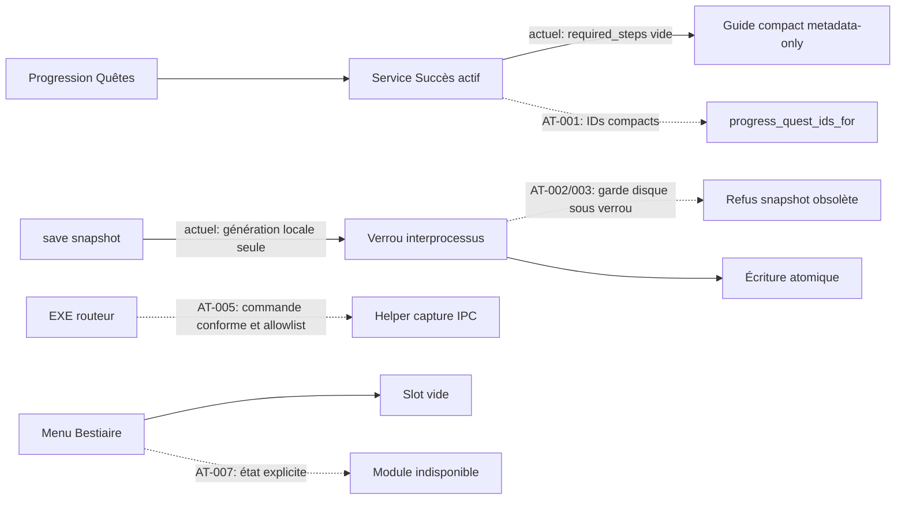

# DOFUS ATLAS — Rapport d’audit et registre de preuves

> **Publication documentaire.** Ce fichier rassemble le rapport d’audit et les décisions individuelles sur les JSON. Les mentions « aucun commit/publication » décrivent la phase d’investigation, antérieure à cette publication autorisée. Le code audité reste le SHA `ac07be9b894718f5e68e7c3a91016d7651e3065b`. Les chemins `evidence/`, `registres/` et `probes/` désignent des pièces conservées hors dépôt dans `/workspace/audit-atlas/` : ces pièces ne sont pas incluses dans ce fichier. Elles sont désormais publiées dans [le dossier complémentaire du même audit](2026-10-14-ac07be9b/README.md), avec une archive complète téléchargeable et un manifeste individuel. L’annexe JSON ci-dessous est incluse intégralement.


Audit du 14 octobre 2026. Dépôt canonique **r9327/Dof-Atlas**, branche **main**, SHA **ac07be9b894718f5e68e7c3a91016d7651e3065b**. HEAD distant et checkout vérifiés au début puis avant rédaction finale, identiques. Code applicatif, données canoniques et workflows non modifiés ; aucun commit, merge, publication ni déclenchement de FULL. Les scripts/probes/livrables de cet audit sont hors dépôt. Les sorties Doctor/Graphify internes restent ignorées par Git.

**Résultat principal :** corriger d’abord le branchement des succès d’alignement et les écritures de snapshots concurrents. Ne pas fusionner la distribution Windows sans réparer les chemins durables, le helper élevé et la préparation des datasets. La majorité des subdivisions, caches compacts et améliorations des lots 1–5 ont une utilité réelle : un grand regroupement de fichiers ou un nouveau découpage JSON général n’est pas justifié.

**Limite de l’expression «intégral» :** tous les fichiers Python suivis ont été effectivement lus et parsés, tous les JSON suivis ont été parsés avec détection de clés répétées, et toutes les sections de nœuds/communautés sont exportées. Cela ne signifie pas qu’un agent a démontré la justesse de chacune des 10 287 définitions ni exécuté toutes leurs branches. La revue sémantique manuelle et les reproductions sont ciblées sur les flux et constats détaillés ci-dessous ; le registre Python indique cette distinction fichier par fichier. Les parcours joueur Windows, le réseau réel, les données brutes Doduda absentes et les longues sessions RAM restent des validations complémentaires. Ce rapport ne constitue ni une preuve d’absence de bugs ni une nouvelle certification produit.

## 1. Provenance, lots précédents et travaux ouverts

`evidence/branches.json` contient chaque ref distante, son SHA, l’écart de commits et les chemins depuis le merge-base. `recent-commits.txt` conserve les changements récents. Aucune branche n’a été supprimée ; les counts Git ne prouvent pas qu’un travail est devenu inutile.

| État | Preuve vérifiée | Conséquence pour cet audit |
|---|---|---|
| Lot 1 — stabilisation | PR #152 fusionnée ; corrections AI Context présentes ; main actuel certifié | Ne pas rouvrir les anciens échecs FULL comme défauts actuels |
| Lot 2 — Guide/Doctor | PR #150 fusionnée ; triage advisory, imports à portée AST et témoins des capacités relus | Les observations de formulation ne deviennent pas des bugs de gameplay |
| Lot 3 — RAM/latence | PR #151 fusionnée ; offsets, compaction, callbacks de catalogue, libération Home et SQLite présents | Conserver les boundaries lazy et les corrections de rétention ; AT-001 révèle un branchement que les témoins synthétiques ne couvrent pas |
| Lot 4 — JSON | squash 8d65f506 ; inventaire/shards dérivés/tests disponibles | Source canonique conservée ; ne pas imposer arbitrairement les shards à l’UI |
| Lot 5 — CI | ac07be9b ; reuse exact ledger et timings présents | Réutilisation effective des stages Guide confirmée dans les logs ; pas de nouvelle FULL lancée |
| PR #138 | aee3484627c660e5c67009a6a541b4b85ccba454, brouillon ; verrou Qt 6.11.2 atomique | main reste en 6.11.1 ; aucune adoption implicite du nouveau lock, smoke natif Windows requis |
| PR #159 | f69072486aa7bfeb6fd91ae41caecea58e16a8f2, brouillon ; checkout séparé non modifié | Constats de distribution AT-004/005/006/025 séparés du produit main |

Preuve distante du HEAD actuel : **Phase Certification 38439698169 / Full Validation = success**, artefact téléchargé et relu. `03_atlas_integrity_full.json` indique head exact, verdict PASS, blockers=[] ; FULL_SUITE exécute 2 555 tests. Les 2 940 «tests» du total de groupes incluent des preuves réutilisées et autres groupes : **ne pas les annoncer comme autant de tests uniques supplémentaires**. Guide CI : 17 checks PASS, prerequisites COMPLETE_BY_PROVIDER_ORDER, zéro erreur dure, final coverage COMPLETE_BY_EVIDENCE. Les résultats actuels portent sur 1 412 succès (691+721), pas sur les 1 418 d’une ancienne photographie documentaire.

[Phase exacte main](https://github.com/r9327/Dof-Atlas/actions/runs/38439698169), [Application FAST main](https://github.com/r9327/Dof-Atlas/actions/runs/38439698103), [réutilisation post-merge et lifecycle](https://github.com/r9327/Dof-Atlas/actions/runs/38443787903). Les jobs non requis sont **skipped**, pas exécutés. Les archives sont conservées dans evidence/ ; un succès de ces workflows n’invalide pas les défauts nouvellement reproduits.

## 2. Couverture des outils et sous-outils

Environnement Linux ; Python initial 3.12, puis **Python 3.13.16 + PySide6 6.11.1 + Pillow 12.3.0** installés pour les validations compatibles. Ce sont des wheels Linux, pas une installation certifiée du lock Windows. Aucun PowerShell/Win32/UAC/Npcap/client Dofus réel exécuté. La compétence cloud et le playbook local `tools/skills/dofus-atlas-tools/SKILL.md` ont été lus et utilisés ; aucune instruction de refactor/publish n’a été invoquée.

| Outil / sous-outil | Exécuté | Périmètre et résultat exploitable | Limite |
|---|---|---|---|
| Git remote/HEAD/branches/PR/log/diff | Oui | SHA réel, 2 PR ouvertes, lots présents, topologie conservée | Pas de nettoyage ni merge |
| AI Context status/drift | Oui | Index CURRENT, état propre, routage lu | Un routeur est une navigation, pas un test métier |
| agent_task_profiles | Oui, best/read-only structural | Carte qualité/consommation archivée | Ne change pas le niveau Doctor |
| tool_catalog + tool_audit | Oui | Tous contrats et candidats accessibles, mutations identifiées | Heuristiques ; faux soupçons de scénarios démontrés AT-028 |
| Doctor quick | Oui | AST global, 898 Python parsés ; motifs enregistrés | Diagnostic ≠ anomalie |
| Doctor audit FAST | Oui, puis rerun avec environnement prêt | Gates META/SYNTAX/GENERATED/ARCHITECTURE/IDENTITY PASS | Premier FAIL dû au Qt manquant ; conservé comme limite environnementale |
| Doctor capabilities | Oui | 18 ancres, call sites et témoins disponibles | Ancres AST ne suffisent pas au comportement |
| Doctor code-inspect | Oui, ciblé et scans par paquets | AST, doublons, lineage/reachability/ressources ; inventaire externe sans cap de fonctions | Budgets 150 files/4 000 fonctions/80 findings ; certaines sorties bornées tronquent le lineage, inventaire complet séparé |
| Doctor graph + rebuild | Oui | Graphify 0.9.72, extract code-only, cluster no-label, HTML, exact SHA PASS | Graphe exporté non dirigé ; les relations inferred ne sont pas des appels prouvés |
| Doctor file-coverage | Oui | Tous les 898 Python suivis représentés | Présence de fichier ≠ accessibilité runtime |
| Doctor graph-audit deep | Oui | Cycles, hubs, cohésion, consumers, plan advisory | CLI limitée ; pagination API complète supplémentaire effectuée |
| Doctor isolate-triage | Oui | Les six orphelins examinés ; aucun dead-code prouvé | Une entrée PS1 ou un __init__ vide peut être nécessaire |
| Doctor consumer-sites/source-impact | Oui | Façade widget, persistence, profils, chemins d’impact | Consumer-sites : 120/176 candidats ; résolution dynamique incomplète, explicitement signalée |
| Doctor file-audit | Oui, 16 fichiers critiques | Assemblage source/Graphify/tests/ressources | 8 fichiers par appel, 80 symboles/fichier dans certaines extensions ; inventaire externe complète les omissions |
| Doctor change-plan | Oui, base avant lots | REVIEW, pas d’import cassé confirmé | Plan advisory ; aucun test automatiquement exécuté |
| Doctor refactor-preview | Oui | Consolidation profil simulée, REVIEW, aucun edit | Ne démontre pas qu’un déplacement est safe |
| Doctor dev-check/dev-event | Oui, lecture seule | Git/AST, événements save, routage borné | Pas un gate de merge |
| Doctor graph-compare | Oui | Lot 4 8d65f506 vs HEAD : aucune nouvelle paire d’import ni cycle, comparaison non tronquée | IDs de communautés non comparables entre clusters |
| Doctor graph-ui | Oui | Export 12 637 nœuds/36 460 liens, pas de troncature du graphe | Enrichissement source seulement 16 fichiers, tronqué ; pas de validation visuelle exhaustive du viewer web |
| Doctor graph-live | Oui, --once | État local courant, sans rebuild | Pas de serveur longue durée ni scénario edit/save interactif |
| Doctor capture-ui qt | Oui | Signal/slot réel, QThread started/finished, destruction observée | Petit scénario Doctor, pas application complète |
| Doctor capture-ui encyclopedia | Oui | Vrais widgets différés + quête synthétique, recherche et destruction | Ne charge pas les 1 976 quêtes productives |
| Doctor capture-ui equipment | Oui | Vrai widget Equipment léger | Builder intégré volontairement désactivé ; ouverture navigateur mockée séparément |
| Doctor capture-ui webengine | Oui | Chromium/QObjects observés, software rendering | Ce scénario ne prouve pas que main utilise WebEngine ; pas de test navigateur équipement production |
| Doctor runtime-trace | Oui via les quatre wrappers capture-ui | Traces exact-SHA, sans instrumentation du lancement normal | Aucun profil de session joueur ; capture-ui n’est pas une capture PNG automatique |
| Doctor scenario-coverage | Oui | Union de preuves positives de quatre traces, non tronquée | Une absence observée ne prouve jamais du code mort |
| Doctor scenario-diff/trend | Non | Témoins des contrats exécutés | Pas de deux traces historiques comparables du même scénario ; répétition artificielle sans valeur évitée |
| Doctor test-costs | Oui | Rapport FULL exact-SHA historique récupéré : coûts des groupes et fixtures | Pas un benchmark nouveau de la machine Linux |
| Doctor live | Oui, 1 s | Inventaire des processus et I/O disponible | Aucune application Windows en session ; ne conclut pas sur sa RAM |
| Doctor perf --files-only | Oui, une passe | Parsing de fichiers, image_manifest 138,532 ms, source_mapping 13,194 ms sur cette machine | Quests_enriched >64 MiB exclu de ce profileur ; parsé séparément pour intégrité, probe encoding ciblée |
| Doctor ponytail/issues/report | Oui | Politique et consolidation des motifs courants | Ne remplace pas le registre de preuve de cet audit |
| Doctor certify | Oui, plan only | Routage/explain/policy accessibles, aucune certification revendiquée | --run, shadow metrics et readiness nécessitent des preuves/parcours supplémentaires |
| Doctor audit CRITICAL/FULL/DEEP, verify hard, all | Non, nouvelle exécution évitée | FULL exacte main déjà disponible et relue ; tests ciblés indépendants exécutés | all relancerait des analyses/benchmarks redondants ; DEEP mutation/fault/random-order pas une inspection read-only exhaustive gratuite |
| Doctor clean, écritures hooks/baseline/dev, graph install-hooks | Non | Contrats lus | Mutations hors phase audit ; Graphify hook install interdit par le dépôt |
| Graphify path/explain/query/affected/god-nodes | Oui | Connexions utiles et sous-graphes, sorties archivées | Path AtlasWindow→HomePage→QuestCatalog est inferred, pas preuve d’appel |
| Graphify diagnose multigraph | Oui | Aucun endpoint manquant/dupliqué dans export, diagnostic suppression disponible | Un export déjà normalisé ne révèle pas toutes les suppressions antérieures du producteur |
| Graphify callflow-html/tree | Oui | Vues complémentaires exportées | Visualisation, pas validation supplémentaire du gameplay |
| Graphify labels LLM/deep semantic, providers/global/multi-repo, DB/Neo4j | Non | CLI disponible inventoriée | Pas de besoin de transfert source/LLM, de PostgreSQL ni de modification globale ; aucun service externe requis pour ces analyses |
| Graphify watch/update/rebuild répété | Non | Baseline et graphe exact déjà disponibles | Un audit sans changement ne justifie pas une boucle de génération |
| Guide integrity fast | Oui | 6/6 checks PASS sur fichiers canoniques | --skip-catalog explicite pour les deux validations structurelles |
| Guide full specialists | Preuves existantes relues, pas réexécutées | Ordre/couverture/hooks/runtime exact main, 17 checks PASS | Raw Doduda absents localement ; pas de simulation substituée à la preuve distante |
| JSON inventory + validation profonde | Oui | Chaque JSON Git parse, duplicate keys/nonfinite et relations accessibles | Runtime/user/generated non suivis séparés ; consumers lexicaux non certifiés |
| JSON shards/parité/benchmark | Oui, voir evidence/shards-* | Générateur actuel testé sur source réelle hors dépôt, comparaison légère unique et parité intégrale PASS | Aucune bascule UI ; mesure locale non Windows/RSS |
| Inspection UI propre à l’audit | Oui | Bestiaire et Equipment rendus en PNG, images vues | Pas de screenshot inventé ; catalogue vide explicite pour le shell Bestiaire |
| EXE/Setup/UAC/Npcap/long soak | Non local | Code PR, contrats et probes de routeur/migration exécutés | Windows et données de production requis ; ancien smoke top-level ne remplace pas les parcours manquants |

Tests ciblés locaux : 212 tests outils/JSON/CI, 288 autres tests Doctor, 47 tests produit/lifecycle et 56 tests distribution PASS. Ces totaux ne prouvent pas l’exhaustivité du produit. Les probes de régression sont des expériences distinctes, dont plusieurs montrent des comportements défectueux malgré ces PASS. Les logs et les commandes sont conservés ; aucune suite FULL locale n’a été appelée.

## 3. Cartographie fonctionnelle et flux vérifiés

| Surface présente | Point d’entrée / propriétaire | Données et retour Home | Verdict de périmètre |
|---|---|---|---|
| Démarrage source | DOFUS.bat → startup_preflight → warmup détaché → launch.main → main.main/AtlasWindow | Préchargement post-render, workers cache et guards mono-instance | Code relu ; Win32/bat non exécutés. Le warmup démarre avant le garde mono-instance |
| Home | main → HomePage ; bridge réseau lazy ; ContinueRequested → open_guide_progress | Guide manuel, personnage canonique, release_encyclopedia_context | Connexions réelles présentes, corrections de rétention lot 3 conservées |
| Quêtes | lazy facade → MemoryBoundEncyclopediaPage → LazyQuestsPage/QuestsPage → QuestProvider/QuestCatalog | JSON raw offsets, SQLite détails, progress coordinator | Parcours synthétique Qt + contrats ciblés ; raw réels couverts par artefact CI, absents localement |
| Guide catalogue/manuels | DeferredAchievementGuidesView → providers compact/indexed → SharedGuideManualView | Catalog JSON par guide, manifeste/chapitres ; Quest/Success progress liés | Renderer partagé utile ; ne pas recréer deux interfaces ; AT-001/011/021 à traiter |
| Succès | AchievementsView → MemoryBoundAchievementProvider → service mémoire/serialized/base | Cache compact, objectifs/critères, propagation des quests | Façades utiles ; AT-001/003 révèlent des lacunes non couvertes par les fakes |
| Bestiaire | main.open_encyclopedia_tab → slots | Aucune vue métier raccordée | AT-007 confirmé ; données monstres/donjons utilisées aussi par Succès ne prouvent pas une UI Bestiaire |
| Métiers/Craft | main.create_craft_page → preload minimal → SQLite adapter → recherche/recettes | DB local, selection JSON, guides métiers générés et images routes | Contrats lazy PASS ; pas de datasets Craft locaux ; AT-023, optimisation filtrage avant limit à confirmer |
| Équipement | EquipmentPage → QDesktopServices.openUrl(Huzounet) | Aucun browser retenu dans production ; page détruite sur Home | Fonctionnalité volontairement externe, AT-022 ; WebEngine reste en diagnostics/packaging |
| Organizer/personnages | OrganizerPage + mixins sessions/drag/drop/hotkeys | ProfileSettingsService/CharacterOrderService, index JSON+INI, icon cache | Ordre/hotkeys/shutdown contrats PASS ; gestion HWND Win32 réelle non exercée |
| Zaaps/déplacements/macros | ZaapWidget → callbacks main → AtlasRuntime → macros Win32/input hooks | Ratio/favoris config, settings/index sessions, MacroLock | Consommateurs dynamiques présents ; pas de suppression des modules type-only ; AT-024 |
| Scan Monde | WorldScanPanel → worker cartographie → WorldService/world_db + manifest/assets/canvas | DB persistante, états maps et liens | Chargeur asynchrone testé ; API import non raccordée identifiée et dangereuse AT-008/009 |
| Réseau/calibration | UI bridge → coordinator → controllers/runtimes → transport/decoders → progress bridge | Fingerprint exact-build, mapping strict, queue/debounce UI, persistence | Contrats défensifs utiles ; SHA AT-010 ; capture réelle et helper EXE AT-005 |
| Almanax | placeholder_page main | Aucun module métier implémenté | État «En travaux» explicite ; à conserver, pas un bug de branchement démontré |

Le retour Home détruit les pages reconstructibles, appelle leurs release_runtime, programme deleteLater puis collecte des cycles. Cela explique des arêtes faibles et des __getattr__ lazy ; les supprimer au nom du graphe augmenterait les imports et la rétention. Les signaux/callbacks/Thread/Popen/singleShot sont inventoriés individuellement dans registres/signaux-callbacks-workers.json. Leur présence n’établit ni leur invocation, ni une fuite. Les tests x50 et les traces courtes apportent une preuve bornée de lifecycle ; aucune absence universelle de fuite native n’est revendiquée.

## 4. Registre des anomalies actionnables

Statuts : **CONFIRMÉ** = preuve suffisante du comportement ou de la lacune décrite ; **PROBABLE** = convergence statique mais effet produit encore à démontrer ; **NON CONFIRMÉ** = suspicion sans preuve ; **FAUX POSITIF** = interprétation d’alerte invalidée. CONFIRMÉ n’indique pas que le défaut se produit à chaque lancement. Les conditions et limites figurent dans chaque fiche.

P0 : aucune panne/corruption d’une session joueur réelle démontrée dans cet environnement. Les risques de progression et bloqueurs de la PR sont classés P1 avec leur déclencheur explicite.

| ID | Priorité | Statut | Portée | Action |
|---|---|---|---|---|
| AT-001 | P1 | CONFIRMÉ | main | Les succès d’alignement perdent les IDs des guides compacts |
| AT-002 | P1 | CONFIRMÉ | main | Guide save() écrase un changement publié par un autre processus |
| AT-003 | P1 | CONFIRMÉ | main | Succès save() présente le même conflit interprocessus |
| AT-004 | P1 | CONFIRMÉ | PR #159 | La distribution ne rend pas toute la progression durable |
| AT-005 | P1 | CONFIRMÉ | PR #159 | Le helper réseau élevé ne peut pas être lancé par l’EXE |
| AT-006 | P1 | CONFIRMÉ | PR #159 | Le build Windows ne matérialise pas les catalogues métier requis |
| AT-007 | P1 | CONFIRMÉ | main | Les quatre entrées Bestiaire ouvrent des onglets vides |
| AT-008 | P1 | CONFIRMÉ | main | L’import explicite de cartographie efface les états des maps |
| AT-009 | P2 | CONFIRMÉ | main | Le validateur cartographique ne vérifie pas les références |
| AT-010 | P2 | CONFIRMÉ | main | Seize validateurs SHA-256 acceptent des empreintes de deux octets |
| AT-011 | P2 | CONFIRMÉ | main | Les caches JSON valides mais de mauvais schéma ne se reconstruisent pas |
| AT-012 | P2 | CONFIRMÉ | main | Lire un préfixe lit actuellement le fichier entier |
| AT-013 | P2 | CONFIRMÉ | main | Les contrats des gros JSON dépendent des fins de ligne Windows |
| AT-014 | P2 | CONFIRMÉ | main | Deux diagnostics distincts partagent le même identifiant Doctor |
| AT-015 | P2 | CONFIRMÉ | main | La découverte de consumers ne résout pas les façades lazy pourtant explicites |
| AT-016 | P2 | CONFIRMÉ | main | La CLI Graph-audit masque une partie des communautés candidates |
| AT-017 | P2 | CONFIRMÉ | main | Le workflow Graphify omet des chemins d’architecture |
| AT-018 | P2 | CONFIRMÉ | main | Les chronométrages FULL montrent encore des fixtures coûteuses ciblables |
| AT-019 | P2 | CONFIRMÉ | main | Les primitives de profil ont deux propriétaires identiques |
| AT-020 | P2 | CONFIRMÉ | main | Le runtime manuel surcharge inutilement trois méthodes du core |
| AT-021 | P2 | PROBABLE | main | Les signatures de caches ne couvrent pas tous leurs inputs |
| AT-022 | P2 | CONFIRMÉ | main | L’ouverture du navigateur annonce un succès en cas d’échec |
| AT-023 | P2 | CONFIRMÉ | main | Craft peut être déclaré prêt avec un catalogue absent |
| AT-024 | P2 | CONFIRMÉ | main | Favoris et calibration Zaap peuvent écraser leurs modifications |
| AT-025 | P2 | PROBABLE | PR #159 | Les EXE contournent encore les chemins compacts |
| AT-026 | P1 | CONFIRMÉ | main | GitHub n’impose que Public PR / Safe Validation |
| AT-027 | P3 | CONFIRMÉ | main | Les suppressions de sélection Craft sont étiquetées seulement x |
| AT-028 | P2 | CONFIRMÉ | main | Le catalogue heuristique sous-estime l’intégration des scénarios Doctor |

### AT-001 — Les succès d’alignement perdent les IDs des guides compacts

**P1 · CONFIRMÉ · main**

**Localisation exacte :** [app/modules/encyclopedia/services/memory_bound_achievement_progress_service.py:15](https://github.com/r9327/Dof-Atlas/blob/ac07be9b894718f5e68e7c3a91016d7651e3065b/app/modules/encyclopedia/services/memory_bound_achievement_progress_service.py#L15) — _alignment_main_quest_ids ; [app/modules/encyclopedia/providers/memory_bound_guide_provider.py:523](https://github.com/r9327/Dof-Atlas/blob/ac07be9b894718f5e68e7c3a91016d7651e3065b/app/modules/encyclopedia/providers/memory_bound_guide_provider.py#L523) — _summary_from_compact_row ; [app/modules/encyclopedia/services/progress_service.py:305](https://github.com/r9327/Dof-Atlas/blob/ac07be9b894718f5e68e7c3a91016d7651e3065b/app/modules/encyclopedia/services/progress_service.py#L305) — sync_from_quest_progress ; [tests/test_memory_bound_achievement_progress.py:66](https://github.com/r9327/Dof-Atlas/blob/ac07be9b894718f5e68e7c3a91016d7651e3065b/tests/test_memory_bound_achievement_progress.py#L66) — test_alignment_progress_uses_compact_guide_summaries ; [tests/test_memory_policy_contract.py:306](https://github.com/r9327/Dof-Atlas/blob/ac07be9b894718f5e68e7c3a91016d7651e3065b/tests/test_memory_policy_contract.py#L306) — test_achievement_sync_uses_compact_alignment_guide_ids

**Problème et cause :** La classe réellement exportée par services/__init__.py surcharge le helper corrigé de la classe de base. Elle lit required_steps dans les résumés compacts, qui n’exposent plus les étapes. Le compteur Pa reste à zéro malgré des quêtes d’alignement terminées. Le témoin actuel utilise un fake qui conserve required_steps ; le garde source vérifie la classe de base, pas l’override actif.

**Preuve :** alignment-contract-reproduction.json : construction réelle des résumés, IDs extraits des deux JSON canoniques ; index compact 109 IDs par guide, helper actif retourne deux tuples vides, helper de base retrouve les IDs. Critère isolé Pa>0 : false dans le service actif, true avec la base. Ces IDs ne représentent pas une nouvelle règle métier de 109 niveaux.

**Correction recommandée :** Lire progress_quest_ids_for en priorité dans le helper actif ; conserver le fallback get_summary_by_id pour les providers de compatibilité. Réutiliser la logique déjà présente dans progress_service, sans réhydrater les détails et sans changer les quêtes canoniques.

**Composants impactés :** Service Succès, provider Guide compact, synchronisation Quêtes→Succès, panneaux d’alignement ; tests ci-dessus.

**Gain :** Rétablit la propagation réelle et conserve l’économie mémoire des résumés. Aucun chiffre de RAM gagné n’est avancé.

**Risque :** Moyen : distinguer alignement principal, quêtes optionnelles et choix d’ordre ; ne pas modifier le sens des critères Pa/Pr.

**Validation :** Un test avec vrais Guide metadata-only et index compact ; Pa>0, Pa aux limites, Bonta/Brâkmar, décochage ; espion interdisant get_by_id et lecture des détails ; tests.test_memory_bound_achievement_progress, tests.test_achievements_lot7, tests.test_progress_concurrent_instances.


### AT-002 — Guide save() écrase un changement publié par un autre processus

**P1 · CONFIRMÉ · main**

**Localisation exacte :** [app/modules/encyclopedia/services/guide_progress_service.py:145](https://github.com/r9327/Dof-Atlas/blob/ac07be9b894718f5e68e7c3a91016d7651e3065b/app/modules/encyclopedia/services/guide_progress_service.py#L145) — GuideProgressService.save

**Problème et cause :** Le verrou interprocessus sérialise l’écriture mais la validation de fraîcheur ne compare que generation, qui est locale au processus. Une écriture externe reste invisible à save() alors que _disk_signature existe déjà.

**Preuve :** reproductions.json/external_snapshot_guide : parent chargé vide, enfant utilisant le vrai setter enregistre une étape, parent save() remet characters à {}. Aucun conflit de verrou ni JSON invalide : perte logique du changement externe.

**Correction recommandée :** Sous le verrou, vérifier aussi la signature disque avant toute écriture de snapshot ; refuser et recharger le snapshot obsolète. Continuer à utiliser les setters ciblés pour les mutations ; ne pas fusionner aveuglément deux arbres complets.

**Composants impactés :** GuideProgressService, appels de compatibilité de save(), services de suppression et tests de concurrence. Le démarrage mono-instance réduit l’exposition ordinaire mais ne prouve pas l’absence d’écrivain externe.

**Gain :** Empêche un écrasement de progression ; coût d’un stat seulement au save, pas à chaque consultation.

**Risque :** Faible à moyen : des appelants de save devront réappliquer explicitement leur mutation après le rejet.

**Validation :** Deux processus réels : écriture enfant puis save parent doit être refusé, données enfant conservées ; mutations ciblées doivent toujours se composer ; corruption et version inconnue restent refusées ; tests.test_guide_progress_persistence, tests.test_progress_concurrent_instances.


### AT-003 — Succès save() présente le même conflit interprocessus

**P1 · CONFIRMÉ · main**

**Localisation exacte :** [app/modules/encyclopedia/services/serialized_achievement_progress_service.py:168](https://github.com/r9327/Dof-Atlas/blob/ac07be9b894718f5e68e7c3a91016d7651e3065b/app/modules/encyclopedia/services/serialized_achievement_progress_service.py#L168) — AchievementProgressService.save

**Problème et cause :** Le service coordonné compare uniquement la génération locale avant de publier le snapshot ; le verrou ne constitue pas une détection de modification antérieure par un autre processus.

**Preuve :** reproductions.json/external_snapshot_achievement : un succès écrit par le setter enfant disparaît après save parent. La perte de snapshot est prouvée ; une fréquence de perte en session normale n’est pas mesurée.

**Correction recommandée :** Même garde disque sous verrou que AT-002. Examiner aussi sync_from_quest_progress : sa lecture à génération locale ne suffit pas à certifier la fraîcheur face à un écrivain externe. Conserver l’optimisation des lectures chaudes, faire le refresh au point de transaction.

**Composants impactés :** Succès manuels, objectifs, dérivations automatiques, suppression de personnage et classes mémoire/serialized/base.

**Gain :** Préserve les validations concurrentes ; pas de nouveau parse à chaque is_achievement_completed.

**Risque :** Moyen : la signature de synchronisation automatique doit être invalidée après reload ; garder la distinction choix manuel/dérivé.

**Validation :** Processus indépendants ; alternance setter objectif/succès et sync ; refus save obsolète ; suppression externe d’un personnage ne doit pas le ressusciter ; tests.test_progress_concurrent_instances et tests.test_network_character_id_progress_storage.


### AT-004 — La distribution ne rend pas toute la progression durable

**P1 · CONFIRMÉ · PR #159**

**Localisation exacte :** [app/distribution/user_data.py:8](https://github.com/r9327/Dof-Atlas/blob/f69072486aa7bfeb6fd91ae41caecea58e16a8f2/app/distribution/user_data.py#L8) — _USER_PATHS ; [app/constants.py:12](https://github.com/r9327/Dof-Atlas/blob/f69072486aa7bfeb6fd91ae41caecea58e16a8f2/app/constants.py#L12) — USER_DATA_ROOT ; [app/modules/encyclopedia/services/guide_progress_service.py:12](https://github.com/r9327/Dof-Atlas/blob/f69072486aa7bfeb6fd91ae41caecea58e16a8f2/app/modules/encyclopedia/services/guide_progress_service.py#L12) — GUIDE_PROGRESS_FILE ; [app/modules/encyclopedia/services/progress_service.py:18](https://github.com/r9327/Dof-Atlas/blob/f69072486aa7bfeb6fd91ae41caecea58e16a8f2/app/modules/encyclopedia/services/progress_service.py#L18) — ACHIEVEMENT_PROGRESS_FILE ; [app/modules/encyclopedia/services/lazy_progress_service.py:9](https://github.com/r9327/Dof-Atlas/blob/f69072486aa7bfeb6fd91ae41caecea58e16a8f2/app/modules/encyclopedia/services/lazy_progress_service.py#L9) — constantes ; [app/cartography/world_db.py:13](https://github.com/r9327/Dof-Atlas/blob/f69072486aa7bfeb6fd91ae41caecea58e16a8f2/app/cartography/world_db.py#L13) — WORLD_DB_PATH ; [local_dofus_data/config.py:10](https://github.com/r9327/Dof-Atlas/blob/f69072486aa7bfeb6fd91ae41caecea58e16a8f2/local_dofus_data/config.py#L10) — DATA_DIR

**Problème et cause :** La PR redirige les profils, Quêtes et la sélection Craft mais Guide/Succès et la base Scan Monde restent dans le dossier de version. La migration n’inclut pas ces trois documents. La base Craft reste également liée à la version : reconstruisible, mais son caractère durable ne doit pas être annoncé.

**Preuve :** reproductions.json/pr159_actual_persistence_paths et pr159_migration_missing : avec DOFUS_ATLAS_USER_ROOT défini, seule QUEST_PROGRESS_FILE va dans user ; les trois fichiers legacy ne sont pas copiés. Ce constat concerne la PR en brouillon, pas une release stable déjà déployée.

**Correction recommandée :** Définir des chemins canoniques explicites de progression et de base Scan Monde sous USER_DATA_ROOT, les utiliser dans les façades lazy et les services. Migrer les anciens fichiers sans écrasement ; sauvegarder la base SQLite via backup/checkpoint compatible WAL. Ne pas rediriger DATA_DIR entier, qui contient les ressources canoniques.

**Composants impactés :** Constantes, services Guide/Succès/lazy, CharacterDataService, Home, Scan Monde, migration installateur ; tests.test_distribution_user_data.

**Gain :** Conserve les validations et scans lors des upgrades/rollback, évite des données métier dans les slots réputés immuables.

**Risque :** Élevé : persistence, reprise legacy, WAL et priorités de copies. Backup préalable et migration idempotente indispensables.

**Validation :** V1 écrit Quêtes+Guide+Succès+Scan ; V2 lit exactement les mêmes états ; rollback V1 les conserve. Migration source legacy, fichiers déjà existants, base avec WAL, interruption, corruption et backups. Vérification des chemins dans un vrai bundle Windows.


### AT-005 — Le helper réseau élevé ne peut pas être lancé par l’EXE

**P1 · CONFIRMÉ · PR #159**

**Localisation exacte :** [launch.py:15](https://github.com/r9327/Dof-Atlas/blob/f69072486aa7bfeb6fd91ae41caecea58e16a8f2/launch.py#L15) — routeur frozen ; [app/network/elevated_capture.py:114](https://github.com/r9327/Dof-Atlas/blob/f69072486aa7bfeb6fd91ae41caecea58e16a8f2/app/network/elevated_capture.py#L114) — launch_elevated_capture_helper ; [app/network/capture_helper.py:150](https://github.com/r9327/Dof-Atlas/blob/f69072486aa7bfeb6fd91ae41caecea58e16a8f2/app/network/capture_helper.py#L150) — main ; [tests/test_distribution_worker_dispatch.py:1](https://github.com/r9327/Dof-Atlas/blob/f69072486aa7bfeb6fd91ae41caecea58e16a8f2/tests/test_distribution_worker_dispatch.py#L1) — contrats

**Problème et cause :** Le producteur utilise -B -m app.network.capture_helper. Le routeur frozen reconnaît uniquement -m en première position ; capture_helper est en outre absent de l’allowlist. La capture nécessitant une élévation ne peut donc pas atteindre son handshake IPC.

**Preuve :** pr159-worker-data-probes.json : -m capture_helper retourne 2 sans dispatch ; les vrais arguments -B -m aboutissent au chemin GUI (témoin isolé 977, aucune UAC exécutée). Lecture du producteur et du routeur concordante.

**Correction recommandée :** Adapter la commande frozen du producteur pour respecter le protocole explicite du routeur et ajouter seulement le helper de capture autorisé. Préserver le refus des modules arbitraires et le token IPC ; ne pas traiter l’EXE comme un interpréteur Python général.

**Composants impactés :** EXE, capture élevée/Npcap, bootstrap et calibration, propagation réseau Quêtes/identité ; packaging hidden imports déjà largement collectés, à vérifier réellement.

**Gain :** Rétablit la capture et la progression automatique dans le mode nécessitant des droits élevés.

**Risque :** Moyen/élevé : séparation de privilèges et arrêt du helper ; ne pas élargir l’exécution arbitraire.

**Validation :** Test producteur→argv→routeur avec les arguments réels ; refus worker inconnu ; Windows standard user + Npcap admin-only, annulation UAC, token erroné, démarrage, changement personnage, arrêt/reconnexion ; tests.test_network_elevated_capture et tests.test_distribution_worker_dispatch.


### AT-006 — Le build Windows ne matérialise pas les catalogues métier requis

**P1 · CONFIRMÉ · PR #159**

**Localisation exacte :** [.github/workflows/atlas-windows-distribution.yml:184](https://github.com/r9327/Dof-Atlas/blob/f69072486aa7bfeb6fd91ae41caecea58e16a8f2/.github/workflows/atlas-windows-distribution.yml#L184) — materialize assets ; [.github/workflows/atlas-windows-distribution.yml:206](https://github.com/r9327/Dof-Atlas/blob/f69072486aa7bfeb6fd91ae41caecea58e16a8f2/.github/workflows/atlas-windows-distribution.yml#L206) — PyInstaller ; [app/constants.py:37](https://github.com/r9327/Dof-Atlas/blob/f69072486aa7bfeb6fd91ae41caecea58e16a8f2/app/constants.py#L37) — RAW_QUEST_DATA_DIR ; [app/quest_catalog.py:261](https://github.com/r9327/Dof-Atlas/blob/f69072486aa7bfeb6fd91ae41caecea58e16a8f2/app/quest_catalog.py#L261) — QuestCatalog.load ; [app/craft_preload.py:37](https://github.com/r9327/Dof-Atlas/blob/f69072486aa7bfeb6fd91ae41caecea58e16a8f2/app/craft_preload.py#L37) — database_path

**Problème et cause :** git lfs pull data/** matérialise les ressources suivies, mais pas les JSON Doduda ignorés ni dofus_data.sqlite. Aucune étape de ce workflow ne lance Doduda ou l’importeur local avant --add-data data. Le smoke vérifie une fenêtre et un répertoire data, pas la disponibilité des modules métier.

**Preuve :** Inventaire Git : aucun fichier sous data/cache/dofus_maps/raw/doduda_cli ni data/local/dofus_data.sqlite. Fresh checkout : QuestSourceError sur quest_categories.json, Craft _skipped_reason=«catalogue Craft local absent». Recette de workflow relue. L’intérieur du gros artefact Windows candidat n’a pas été téléchargé : l’omission est prouvée dans la recette, pas une inspection binaire exhaustive de cet artefact.

**Correction recommandée :** Matérialiser/valider les données runtime nécessaires avant packaging et les inclure explicitement, avec provenance de version et inventaire hashé. Exécuter un parcours réel Quêtes/Succès/Guide/Craft depuis le bundle sans accès au checkout source. Ne pas embarquer les outils Doctor/Graphify pour combler cette absence.

**Composants impactés :** Workflow Windows, bundle, importeurs/caches, release manifest et smoke ; export App-only n’est pas la preuve de disponibilité des données générées.

**Gain :** Permet une application réellement utilisable sans Python ni dépôt source ; le coût disque exact nécessite le bundle corrigé.

**Risque :** Élevé : formats externes, taille d’archive et distribution des ressources ; réutiliser le protocole multipart déjà réalisé.

**Validation :** Machine Windows vierge et offline après installation : catalogues non vides, détail d’une quête, succès et guide liés, recette et recherche ; chaque chemin lu doit être sous bundle/user. Inventaire raw/SQLite et vérification de leur provenance avant build.


### AT-007 — Les quatre entrées Bestiaire ouvrent des onglets vides

**P1 · CONFIRMÉ · main**

**Localisation exacte :** [main.py:965](https://github.com/r9327/Dof-Atlas/blob/ac07be9b894718f5e68e7c3a91016d7651e3065b/main.py#L965) — menu Bestiaire ; [app/modules/encyclopedia/constants.py:6](https://github.com/r9327/Dof-Atlas/blob/ac07be9b894718f5e68e7c3a91016d7651e3065b/app/modules/encyclopedia/constants.py#L6) — onglets Bestiaire ; [app/modules/encyclopedia/views/encyclopedia_page.py:245](https://github.com/r9327/Dof-Atlas/blob/ac07be9b894718f5e68e7c3a91016d7651e3065b/app/modules/encyclopedia/views/encyclopedia_page.py#L245) — création des slots ; [app/modules/encyclopedia/views/encyclopedia_page.py:265](https://github.com/r9327/Dof-Atlas/blob/ac07be9b894718f5e68e7c3a91016d7651e3065b/app/modules/encyclopedia/views/encyclopedia_page.py#L265) — ensure_tab_loaded ; [app/modules/encyclopedia/views/encyclopedia_page.py:451](https://github.com/r9327/Dof-Atlas/blob/ac07be9b894718f5e68e7c3a91016d7651e3065b/app/modules/encyclopedia/views/encyclopedia_page.py#L451) — on_search_changed

**Problème et cause :** DONJONS, MONSTRES, ARCHIMONSTRES et AVIS DE RECHERCHE sont proposés par la navigation, mais aucun constructeur de vue ne remplace leurs EncyclopediaLazySlot. La recherche commune reste visible sans consumer pour ces widgets.

**Preuve :** ui-probe.json : pour chacun, QWidget sans layout ni enfants ; capture bestiary-empty.png inspectée. Catalogue vide injecté pour isoler le shell ; le code de chargement ne contient aucune branche Bestiaire, quel que soit le contenu du catalogue.

**Correction recommandée :** Correction immédiate minimale : état «module en préparation» explicite, recherche désactivée, retour/navigation cohérents. La construction d’un vrai Bestiaire constitue ensuite un lot fonctionnel distinct fondé sur les données existantes, pas une fusion opportuniste de widgets.

**Composants impactés :** Menu main, slots Encyclopédie et recherche ; futurs providers monstres/donjons. Conserver les onglets utiles et ne pas faire croire qu’ils sont implémentés.

**Gain :** Supprime un parcours sans résultat et une recherche inerte ; rend le statut fonctionnel honnête.

**Risque :** Faible pour l’état indisponible ; élevé pour une implémentation complète hors correction minimale.

**Validation :** Ouvrir les quatre commandes depuis main et vérifier un état explicite ; retour Home ; pas de spinner infini ni recherche active sans consumer ; tests de navigation du shell + scénario Qt ciblé.


### AT-008 — L’import explicite de cartographie efface les états des maps

**P1 · CONFIRMÉ · main**

**Localisation exacte :** [app/cartography/map_view_manifest.py:92](https://github.com/r9327/Dof-Atlas/blob/ac07be9b894718f5e68e7c3a91016d7651e3065b/app/cartography/map_view_manifest.py#L92) — import_map_view_manifest ; [app/cartography/map_view_manifest.py:126](https://github.com/r9327/Dof-Atlas/blob/ac07be9b894718f5e68e7c3a91016d7651e3065b/app/cartography/map_view_manifest.py#L126) — replace_view_children ; [app/cartography/world_db.py:370](https://github.com/r9327/Dof-Atlas/blob/ac07be9b894718f5e68e7c3a91016d7651e3065b/app/cartography/world_db.py#L370) — replace_view_children ; [app/cartography/world_db.py:318](https://github.com/r9327/Dof-Atlas/blob/ac07be9b894718f5e68e7c3a91016d7651e3065b/app/cartography/world_db.py#L318) — upsert_map ; [app/ui/world_scan_panel.py:237](https://github.com/r9327/Dof-Atlas/blob/ac07be9b894718f5e68e7c3a91016d7651e3065b/app/ui/world_scan_panel.py#L237) — import_manifest

**Problème et cause :** L’import supprime maps/map_links puis réinsère les seeds ; status, scan_count, last_seen_at sont perdus. Les nombreuses connexions_scope indépendantes rendent aussi l’ensemble non transactionnel en cas d’erreur intermédiaire. Aucun import automatique au démarrage ni bouton connecté à import_manifest n’a été démontré : le risque actuel est sur l’API/outil d’import explicite.

**Preuve :** reproductions.json/world_reimport : current/scan_count=1 devient unverified/0/last_seen_at=null sans erreur. Lecture des DELETE et des transactions séparées. Une perte sur démarrage ordinaire serait un diagnostic inventé.

**Correction recommandée :** Importer la géométrie et les liens dans une seule transaction ; préserver les colonnes de progression des maps existantes. Suppression des maps disparues seulement sous une politique explicite avec backup. Ne pas reconnecter cette méthode à l’UI avant correction.

**Composants impactés :** WorldService, importeur, World DB, Scan Monde ; futur outil de reconstruction de seed.

**Gain :** Préserve l’historique et rend un import interrompu récupérable.

**Risque :** Moyen/élevé : distinguer seed de données et états utilisateur ; migrations SQLite testées.

**Validation :** Réimport idempotent d’une base scannée ; conserver statut/compteurs/date ; injection d’erreur après quelques lignes : rollback complet ; géométrie changée ; liens modifiés ; sauvegarde préalable ; tests.test_world_db + nouveau test importeur.


### AT-009 — Le validateur cartographique ne vérifie pas les références

**P2 · CONFIRMÉ · main**

**Localisation exacte :** [app/cartography/map_view_manifest.py:35](https://github.com/r9327/Dof-Atlas/blob/ac07be9b894718f5e68e7c3a91016d7651e3065b/app/cartography/map_view_manifest.py#L35) — validate_manifest ; [app/cartography/world_db.py:135](https://github.com/r9327/Dof-Atlas/blob/ac07be9b894718f5e68e7c3a91016d7651e3065b/app/cartography/world_db.py#L135) — schéma maps/map_links

**Problème et cause :** Il exige un target_view_key non vide mais accepte une cible inexistante, des parents absents et n’écarte pas les coordonnées dupliquées. PRAGMA foreign_keys est activé sans contraintes de références dans ce schéma.

**Preuve :** reproductions.json/world_reference_validator retourne [] pour un lien vers missing_target. Les JSON actuels contrôlés ne contiennent aucun parent/cible manquant, doublon de coordonnées ou map hors bornes : lacune de validation confirmée, corruption actuelle non confirmée.

**Correction recommandée :** Validation en deux passes des clés de vues et des liens/parents ; détection des doublons (view,x,y), cycles parent et coordonnées invalides. Les liens externes autorisés doivent être déclarés explicitement, pas refusés arbitrairement.

**Composants impactés :** Manifestes Scan Monde, importeur et tests ; contraintes SQL seulement si une migration simple est justifiée.

**Gain :** Empêche de futures navigations cassées et évite une importation partielle.

**Risque :** Faible/moyen : certains liens externes peuvent être légitimes ; vérifier leur contrat avant de bloquer.

**Validation :** Cible/parent absents, cycle parent, doublons, bool/float/coordonnées invalides ; manifeste actuel toujours PASS ; dry-run ne doit pas modifier la DB.


### AT-010 — Seize validateurs SHA-256 acceptent des empreintes de deux octets

**P2 · CONFIRMÉ · main**

**Localisation exacte :** [app/network/mapping_manifest.py:493](https://github.com/r9327/Dof-Atlas/blob/ac07be9b894718f5e68e7c3a91016d7651e3065b/app/network/mapping_manifest.py#L493) — _is_sha256 ; [app/network/mapping_registry.py:84](https://github.com/r9327/Dof-Atlas/blob/ac07be9b894718f5e68e7c3a91016d7651e3065b/app/network/mapping_registry.py#L84) — _is_sha256 ; [app/network/bootstrap.py:273](https://github.com/r9327/Dof-Atlas/blob/ac07be9b894718f5e68e7c3a91016d7651e3065b/app/network/bootstrap.py#L273) — _is_sha256 ; [app/network/current_protocol_profile.py:210](https://github.com/r9327/Dof-Atlas/blob/ac07be9b894718f5e68e7c3a91016d7651e3065b/app/network/current_protocol_profile.py#L210) — _is_sha256 ; [app/network/quest_snapshot_decoder.py:260](https://github.com/r9327/Dof-Atlas/blob/ac07be9b894718f5e68e7c3a91016d7651e3065b/app/network/quest_snapshot_decoder.py#L260) — _is_sha256

**Problème et cause :** len(value)==64 + bytes.fromhex(value) ne garantit pas 32 octets hexadécimaux : fromhex ignore les espaces internes. La même fonction est dupliquée dans seize modules ; la liste complète des chemins/lignes est dans reproductions.json/sha256_validators.

**Preuve :** «aa» + 60 espaces + «bb» a longueur 64 et décode 2 octets. Les seize helpers l’acceptent. sha-parser-reproduction.json : parse_protocol_mapping accepte le manifeste et ProtocolMappingRegistry.select retourne usable=true/exact_match pour cette fausse empreinte. Aucun contournement avec une vraie empreinte Unity n’a été démontré.

**Correction recommandée :** Valider exactement 64 caractères ASCII hexadécimaux et/ou exactement 32 octets sans whitespace. Réutiliser une unique fonction légère dans app/network/contracts.py ; garder les règles de normalisation aux frontières et les types stricts.

**Composants impactés :** Tous les validateurs listés, mapping registry/manifests, décodeurs, calibration et bootstrap. Tester les consommateurs, pas uniquement le helper.

**Gain :** Contrat d’intégrité exact et suppression d’une duplication qui a propagé le défaut.

**Risque :** Faible/moyen : majuscules historiquement acceptées à normaliser ; ne pas refuser un format réellement supporté sans migration.

**Validation :** Whitespace interne, non-ASCII, mauvaise longueur, bool/None, uppercase supporté ; parser et registry doivent rejeter ; tests.test_network_mapping_registry, tests.test_network_mapped_decoder, tests.test_network_protocol_calibration.


### AT-011 — Les caches JSON valides mais de mauvais schéma ne se reconstruisent pas

**P2 · CONFIRMÉ · main**

**Localisation exacte :** [app/modules/encyclopedia/providers/dofus_item_provider.py:78](https://github.com/r9327/Dof-Atlas/blob/ac07be9b894718f5e68e7c3a91016d7651e3065b/app/modules/encyclopedia/providers/dofus_item_provider.py#L78) — _read_guide_items_index ; [app/modules/encyclopedia/providers/memory_bound_guide_provider.py:47](https://github.com/r9327/Dof-Atlas/blob/ac07be9b894718f5e68e7c3a91016d7651e3065b/app/modules/encyclopedia/providers/memory_bound_guide_provider.py#L47) — _guide_compact_cache_valid ; [app/modules/encyclopedia/providers/memory_bound_achievement_provider.py:68](https://github.com/r9327/Dof-Atlas/blob/ac07be9b894718f5e68e7c3a91016d7651e3065b/app/modules/encyclopedia/providers/memory_bound_achievement_provider.py#L68) — _achievement_compact_cache_valid ; [app/modules/encyclopedia/services/guide_ultime_manual_runtime_core.py:228](https://github.com/r9327/Dof-Atlas/blob/ac07be9b894718f5e68e7c3a91016d7651e3065b/app/modules/encyclopedia/services/guide_ultime_manual_runtime_core.py#L228) — restore_manual_runtime_compact_cache ; [app/startup_cache_warmup.py:161](https://github.com/r9327/Dof-Atlas/blob/ac07be9b894718f5e68e7c3a91016d7651e3065b/app/startup_cache_warmup.py#L161) — _load_manifest

**Problème et cause :** Les try/except protègent le parsing JSON, puis int(schema_version) est appelé hors du bloc protégé. Un cache reconstruisible avec schema_version="broken" provoque ValueError plutôt qu’un miss/fallback.

**Preuve :** reproductions.json/guide_item_cache_recovery et cache-recovery-probes.json : exception réelle dans les cinq lecteurs. Le fichier source canonique n’est pas corrompu ; seul le cache isolé l’est.

**Correction recommandée :** Valider type et version sans conversion risquée, considérer un mauvais cache comme miss et reconstruire une seule fois. Conserver le refus strict des documents persistants utilisateur : ne pas généraliser ce fallback à leur progression.

**Composants impactés :** Warmup et providers compacts ; lecteurs de cartes manuelles ; tests de corruption de cache.

**Gain :** Récupération après corruption logique d’un cache, au lieu d’un chargement impossible.

**Risque :** Faible : garder une trace claire et borner les retries ; une source réellement absente doit rester une erreur.

**Validation :** Versions non numériques, bool, float, liste ; JSON tronqué ; index sidecar absent/incohérent ; rebuild unique ; progression corrompue toujours sauvegardée/refusée.


### AT-012 — Lire un préfixe lit actuellement le fichier entier

**P2 · CONFIRMÉ · main**

**Localisation exacte :** [local_dofus_data/utils.py:18](https://github.com/r9327/Dof-Atlas/blob/ac07be9b894718f5e68e7c3a91016d7651e3065b/local_dofus_data/utils.py#L18) — detect_encoding ; [app/modules/encyclopedia/tools/audit_quests_guides.py:848](https://github.com/r9327/Dof-Atlas/blob/ac07be9b894718f5e68e7c3a91016d7651e3065b/app/modules/encyclopedia/tools/audit_quests_guides.py#L848) — is_exploitable_image ; [tests/test_quests_guides_audit.py:19](https://github.com/r9327/Dof-Atlas/blob/ac07be9b894718f5e68e7c3a91016d7651e3065b/tests/test_quests_guides_audit.py#L19) — _ci_image_source_is_valid

**Problème et cause :** read_bytes()[:4] et read_bytes()[:16] allouent et lisent tout le contenu avant de couper le préfixe. Le wrapper de test relit aussi le fichier entier avant le contrôleur image. SVG read_text()[:512] présente le même problème.

**Preuve :** reproductions.json/encoding_probe : fichier de 72 317 050 octets, pic tracemalloc 72 321 995 octets pour détecter UTF-8. Mesure isolée de la fonction, pas RSS de l’application. Recherche des consommateurs : importeurs JSON/maps/d2i/cache.

**Correction recommandée :** Ouvrir en binaire et lire 4/16/513 octets selon le contrat ; pour SVG limiter réellement la lecture. Le test LFS doit conserver la validation du pointeur entier borné et refuser les pointeurs malformés. Ne pas annoncer qu’une signature PNG prouve tout le décodage.

**Composants impactés :** Importeurs local_dofus_data et audit images/tests ; aucun changement de format disque.

**Gain :** Supprime jusqu’à environ 69 MiB d’allocation transitoire sur le cas mesuré ; réduction I/O directe. Le gain global de démarrage et les secondes CI restent à mesurer après correction.

**Risque :** Faible : BOM UTF-8/UTF-16, fichiers vides/courts et svg/pointeurs LFS à préserver.

**Validation :** Spy sur read(n) et gros fichier ; BOM ; pointeurs LFS valides/malformés ; signatures image ; tests.test_quests_guides_audit ne doit pas assouplir ses assertions métier.


### AT-013 — Les contrats des gros JSON dépendent des fins de ligne Windows

**P2 · CONFIRMÉ · main**

**Localisation exacte :** [data/large_file_contracts.json:6](https://github.com/r9327/Dof-Atlas/blob/ac07be9b894718f5e68e7c3a91016d7651e3065b/data/large_file_contracts.json#L6) — sha256 de quests_enriched ; [data/large_file_contracts.json:19](https://github.com/r9327/Dof-Atlas/blob/ac07be9b894718f5e68e7c3a91016d7651e3065b/data/large_file_contracts.json#L19) — sha256 de image_manifest ; [tools/atlas_doctor_lib/audit.py:395](https://github.com/r9327/Dof-Atlas/blob/ac07be9b894718f5e68e7c3a91016d7651e3065b/tools/atlas_doctor_lib/audit.py#L395) — _validated_large_file_contracts ; [tools/atlas_json_inventory.py:24](https://github.com/r9327/Dof-Atlas/blob/ac07be9b894718f5e68e7c3a91016d7651e3065b/tools/atlas_json_inventory.py#L24) — _sha256 ; [.gitattributes:1](https://github.com/r9327/Dof-Atlas/blob/ac07be9b894718f5e68e7c3a91016d7651e3065b/.gitattributes#L1) — text=auto

**Problème et cause :** Les empreintes du contrat sont celles des fichiers CRLF, alors que Git fournit LF ici. Doctor et l’inventaire affichent deux contrats invalides sur le même contenu logique du commit.

**Preuve :** SHA LF quests=e6d7c5b90ced5768c4b4f4b044146c9928bef23286547001ae0cff97a75bf165 ; image=c2c32139d1a6d14cb77936aa586b7a34fcf3a0525e395c882f0902e6e9b6729d. Conversion LF→CRLF reproduit exactement les deux empreintes attendues. Faux positif de corruption, vrai défaut de portabilité du contrat.

**Correction recommandée :** Choisir une représentation byte canonique explicite (eol=lf pour ces JSON et régénération autorisée des empreintes) ou un hash du blob Git canonique clairement séparé de l’intégrité disque. Éviter un hash JSON sémantique qui pourrait masquer une corruption.

**Composants impactés :** gitattributes, producteurs des contrats, Doctor et inventaire/shards si leurs identités byte changent ; tous les consommateurs métier doivent conserver la parité.

**Gain :** Diagnostics concordants Linux/Windows ; aucune réduction RAM prétendue.

**Risque :** Moyen : invalidation attendue de caches/shards et index AI Context ; préserver la provenance des données.

**Validation :** Checkout LF/CRLF, altération réelle rejetée, JSON sémantiquement identique ; tests.test_atlas_doctor, tests.test_atlas_json_inventory et parité du source entier.


### AT-014 — Deux diagnostics distincts partagent le même identifiant Doctor

**P2 · CONFIRMÉ · main**

**Localisation exacte :** [tools/atlas_doctor_lib/core.py:29](https://github.com/r9327/Dof-Atlas/blob/ac07be9b894718f5e68e7c3a91016d7651e3065b/tools/atlas_doctor_lib/core.py#L29) — Issue.id ; [tools/atlas_doctor_lib/audit.py:713](https://github.com/r9327/Dof-Atlas/blob/ac07be9b894718f5e68e7c3a91016d7651e3065b/tools/atlas_doctor_lib/audit.py#L713) — émission invalid_large_file_contract

**Problème et cause :** L’ID ne contient que rule/path/line/title. Les deux entrées de large_file_contracts.json ont toutes ces valeurs identiques et donc le même ID, malgré des cibles différentes. Une comparaison/indexation par ID peut les écraser.

**Preuve :** doctor-fast-py313.json contient deux erreurs files[0]/files[1] avec id=cad8e520683a3aee. La collision est prouvée ; une perte effective dans une UI particulière n’est pas prétendue.

**Correction recommandée :** Ajouter un sujet stable (chemin du fichier contracté ou JSON pointer de l’entrée) à l’identité. Garder l’identité stable quand le texte de preuve/digest change.

**Composants impactés :** Issue, comparateurs de rapports, triage, UI Doctor et tests d’IDs.

**Gain :** Registre complet et comparaison fiable, sans masquer une alerte derrière l’autre.

**Risque :** Faible/moyen : anciennes baselines auront des IDs différents ; prévoir une lecture compatible si nécessaire.

**Validation :** Deux contrats distincts donnent deux IDs ; réordonner le manifeste ne change pas l’ID basé sur le sujet ; changer le hash ne crée pas une fausse nouvelle cible ; comparaison avant/après corrige une seule entrée.


### AT-015 — La découverte de consumers ne résout pas les façades lazy pourtant explicites

**P2 · CONFIRMÉ · main**

**Localisation exacte :** [tools/atlas_doctor_lib/consumer_sites.py:55](https://github.com/r9327/Dof-Atlas/blob/ac07be9b894718f5e68e7c3a91016d7651e3065b/tools/atlas_doctor_lib/consumer_sites.py#L55) — inspect_consumer_sites ; [app/modules/encyclopedia/widgets/__init__.py:16](https://github.com/r9327/Dof-Atlas/blob/ac07be9b894718f5e68e7c3a91016d7651e3065b/app/modules/encyclopedia/widgets/__init__.py#L16) — _LAZY_EXPORT_MODULES ; [app/modules/encyclopedia/widgets/__init__.py:104](https://github.com/r9327/Dof-Atlas/blob/ac07be9b894718f5e68e7c3a91016d7651e3065b/app/modules/encyclopedia/widgets/__init__.py#L104) — __getattr__

**Problème et cause :** Pour GuideStepWidget le rapport n’établit aucun consumer statique, cite l’import f-string comme UNKNOWN_TARGET et s’arrête à 120 fichiers sur 176 candidats. La table littérale locale indique pourtant exactement le module exporté. Cela ne prouve pas que ce widget est utilisé dans un parcours produit, mais permet de prouver l’exposition publique.

**Preuve :** consumer-lazy-widget.out et façade relue : GuideStepWidget→guide_step_widget. Les sept alertes unreferenced_module concernent des modules exportés dans la même table. Tests des exports lazy PASS ; aucun de ces fichiers n’est déclaré mort dans ce rapport.

**Correction recommandée :** Compléter l’analyse AST par la résolution limitée des dictionnaires littéraux de façades du dépôt ; étiqueter PUBLIC_LAZY_EXPORT séparément de RUNTIME_CONSUMER. Garder l’état REVIEW pour les appels réellement dynamiques ; proposer une pagination/partition des candidats.

**Composants impactés :** Consumer-sites, source-impact et triage Graphify ; facades modèles/services/pages et leurs tests.

**Gain :** Moins de faux soupçons d’orphelins, meilleure preuve de compatibilité publique, sans hydrater Qt ni les catalogues.

**Risque :** Faible/moyen : résolution limitée et sans exécution, éviter de transformer une API exposée en preuve de fonctionnalité utilisée.

**Validation :** Dict littéral + f-string package, alias et clé inconnue ; exports réels sans import préalable ; aucun safe_to_delete si preuve dynamique incomplète ; tests.test_atlas_doctor_consumer_sites et tests.test_encyclopedia_widgets_lazy_exports.


### AT-016 — La CLI Graph-audit masque une partie des communautés candidates

**P2 · CONFIRMÉ · main**

**Localisation exacte :** [tools/atlas_doctor.py:700](https://github.com/r9327/Dof-Atlas/blob/ac07be9b894718f5e68e7c3a91016d7651e3065b/tools/atlas_doctor.py#L700) — graph-audit parser ; [tools/atlas_doctor_lib/graph_audit.py:54](https://github.com/r9327/Dof-Atlas/blob/ac07be9b894718f5e68e7c3a91016d7651e3065b/tools/atlas_doctor_lib/graph_audit.py#L54) — inspect_graph ; [tools/atlas_doctor_lib/graph_audit.py:235](https://github.com/r9327/Dof-Atlas/blob/ac07be9b894718f5e68e7c3a91016d7651e3065b/tools/atlas_doctor_lib/graph_audit.py#L235) — sections paginées ; [tools/atlas_doctor_lib/graph_intelligence.py:484](https://github.com/r9327/Dof-Atlas/blob/ac07be9b894718f5e68e7c3a91016d7651e3065b/tools/atlas_doctor_lib/graph_intelligence.py#L484) — analyze_community_boundaries

**Problème et cause :** La CLI expose --offset pour les weak nodes seulement ; inspect_graph permet pourtant community_offset/orphan_offset. La cohésion et le plan limitent aussi l’affichage à 30. Un seul graph-audit --deep n’est pas l’exhaustivité annoncée par une utilisation superficielle.

**Preuve :** graph-audit-0.json/limits : 334 candidats weak, 107 communautés isolées, 77 communautés non rapportées. La pagination API a été effectuée dans cet audit ; graph-all-candidates.json et graph-communities.json contiennent toutes les sections. Il ne s’agit pas de 107 défauts.

**Correction recommandée :** Exposer les offsets de sections existants ou un export intégral borné explicite. Marquer la troncature et le total dans chaque section ; réutiliser un graphe chargé une seule fois, sans refaire une lourde recherche globale par page.

**Composants impactés :** CLI Doctor, Graph-audit/cohésion/plan et UI ; garder FAST peu coûteux.

**Gain :** Permet une couverture reviewable de tous les candidats, évite l’arrêt sur les trente premiers.

**Risque :** Faible : budgets et statut advisory inchangés.

**Validation :** Plus de 30 communautés et 30 weak : union des pages exactement égale à l’ensemble attendu, sans doublon ni oubli ; tests.test_atlas_doctor_graph_audit et tests.test_atlas_doctor_graph_intelligence.


### AT-017 — Le workflow Graphify omet des chemins d’architecture

**P2 · CONFIRMÉ · main**

**Localisation exacte :** [.github/workflows/graphify-map.yml:10](https://github.com/r9327/Dof-Atlas/blob/ac07be9b894718f5e68e7c3a91016d7651e3065b/.github/workflows/graphify-map.yml#L10) — pull_request.paths ; [.github/workflows/graphify-map.yml:22](https://github.com/r9327/Dof-Atlas/blob/ac07be9b894718f5e68e7c3a91016d7651e3065b/.github/workflows/graphify-map.yml#L22) — push.paths

**Problème et cause :** Les filtres contiennent app/** et quelques outils, mais omettent main.py, launch.py et local_dofus_data/** ainsi que de nombreux moteurs Doctor. Une modification de ces points d’entrée/providers peut ne pas produire de carte exacte-SHA.

**Preuve :** Filtres YAML relus ; aucune run Graphify Code Map n’est associée au HEAD ac07be9b, qui change principalement tools/tests. La carte du lot 4 a dû être comparée à un graphe local du HEAD. Ce manque d’artefact ne signifie pas une régression du produit.

**Correction recommandée :** Étendre les chemins structuraux pertinents (entrées, données locales, Doctor/Agent/Graphify). Garder les docs/données-only et les petites modifications hors rebuild coûteux lorsque la politique le permet ; signaler clairement STALE/MISSING et le besoin de rebuild local.

**Composants impactés :** Workflow Graphify, contrat exact-SHA des plans structuraux, tests de routage/budget.

**Gain :** Couvre les changements d’architecture omis, sans obliger une FULL ni un rebuild sur chaque commentaire documentaire.

**Risque :** Faible/moyen : augmentation limitée des runs AST, surveiller le budget existant.

**Validation :** Changements isolés de main.py, launch.py, local_dofus_data et moteurs Doctor déclenchent le bon routage ; docs-only ne déclenchent pas un rebuild non justifié ; tests.test_graphify_workflow_budget et tests.test_ci_runner_guardrails.


### AT-018 — Les chronométrages FULL montrent encore des fixtures coûteuses ciblables

**P2 · CONFIRMÉ · main**

**Localisation exacte :** [tests/test_quests_guides_audit.py:34](https://github.com/r9327/Dof-Atlas/blob/ac07be9b894718f5e68e7c3a91016d7651e3065b/tests/test_quests_guides_audit.py#L34) — QuestsGuidesAuditTests.setUpClass ; [tests/test_lanyel_home_route_map_count.py:26](https://github.com/r9327/Dof-Atlas/blob/ac07be9b894718f5e68e7c3a91016d7651e3065b/tests/test_lanyel_home_route_map_count.py#L26) — setUpClass ; [tests/test_lanyel_shared_manual_ui.py:36](https://github.com/r9327/Dof-Atlas/blob/ac07be9b894718f5e68e7c3a91016d7651e3065b/tests/test_lanyel_shared_manual_ui.py#L36) — setUpClass ; [tests/test_encyclopedia_final_mission.py:28](https://github.com/r9327/Dof-Atlas/blob/ac07be9b894718f5e68e7c3a91016d7651e3065b/tests/test_encyclopedia_final_mission.py#L28) — setUpClass

**Problème et cause :** L’audit de cohérence global et plusieurs classes UI reconstruisent leurs providers/catalogues. Le lot 5 a déjà supprimé des répétitions de stages et amélioré test_guides_catalog_fill : ne pas refaire ce travail.

**Preuve :** Artefact GitHub exact ac07be9b : fixture avant test_active_quest_catalog_identity_is_consistent=226,708 s ; Lanyel map count=44,775 s ; Lanyel shared UI=46,098 s. FULL=1 490,593 s au niveau groupe, 2 555 tests. Les temps de fixtures sont mesurés ; la part réellement évitable n’est pas isolée.

**Correction recommandée :** Traiter d’abord les lectures de préfixes AT-012 puis comparer les phases de build_audit. Réutiliser les caches disque/artefacts déjà disponibles et les fixtures immuables réellement partageables ; garder les états de progression/Qt isolés et les assertions de richesse. Éviter un nouveau singleton mutable global.

**Composants impactés :** Tests cités et auditeur, timing ledger ; aucune modification de budgets produit.

**Gain :** Gain probable sur I/O et setup ; ne pas promettre 226 s supprimées ni additionner tous les temps comme économie certaine.

**Risque :** Moyen : contamination entre tests, fixtures stale et mémoire de suite ; validation d’ordre et signatures nécessaires.

**Validation :** Comparer les mêmes fixtures sur un candidat stabilisé, garder tous les tests/IDs et un ledger exact ; parité audit complet ; ordre aléatoire ciblé pour une fixture partagée. Une seule FULL finale si le lot la justifie, aucune boucle benchmark.


### AT-019 — Les primitives de profil ont deux propriétaires identiques

**P2 · CONFIRMÉ · main**

**Localisation exacte :** [app/storage.py:622](https://github.com/r9327/Dof-Atlas/blob/ac07be9b894718f5e68e7c3a91016d7651e3065b/app/storage.py#L622) — default_profiles ; [app/storage.py:638](https://github.com/r9327/Dof-Atlas/blob/ac07be9b894718f5e68e7c3a91016d7651e3065b/app/storage.py#L638) — profile_bool ; [app/storage.py:645](https://github.com/r9327/Dof-Atlas/blob/ac07be9b894718f5e68e7c3a91016d7651e3065b/app/storage.py#L645) — parse_zaap_click_position ; [app/core/profile_settings.py:27](https://github.com/r9327/Dof-Atlas/blob/ac07be9b894718f5e68e7c3a91016d7651e3065b/app/core/profile_settings.py#L27) — default_profiles ; [app/core/profile_settings.py:43](https://github.com/r9327/Dof-Atlas/blob/ac07be9b894718f5e68e7c3a91016d7651e3065b/app/core/profile_settings.py#L43) — profile_bool ; [app/core/profile_settings.py:50](https://github.com/r9327/Dof-Atlas/blob/ac07be9b894718f5e68e7c3a91016d7651e3065b/app/core/profile_settings.py#L50) — parse_zaap_click_position ; [app/core/profile_settings.py:64](https://github.com/r9327/Dof-Atlas/blob/ac07be9b894718f5e68e7c3a91016d7651e3065b/app/core/profile_settings.py#L64) — parse_unit_ratio ; [app/core/zaap_shortcuts.py:12](https://github.com/r9327/Dof-Atlas/blob/ac07be9b894718f5e68e7c3a91016d7651e3065b/app/core/zaap_shortcuts.py#L12) — parse_unit_ratio

**Problème et cause :** Les corps AST sont identiques pour les defaults, conversion bool, coordonnées et ratio. Le découplage léger du core est utile ; conserver deux implémentations métier n’est pas nécessaire.

**Preuve :** exact-duplicates.json et code relu ; source-impact-storage.out liste les chemins consommateurs. storage utilise déjà le parseur ratio canonique Zaap.

**Correction recommandée :** Importer/re-exporter les trois primitives depuis core/profile_settings dans storage, puis faire utiliser le parseur ratio existant de core/zaap_shortcuts par profile_settings. Conserver les noms publics et ne jamais faire importer storage/Qt par le core.

**Composants impactés :** Runtime macros/settings, Organizer, main, façade session_manager_pyside et tests de shell ; pas de fusion de storage.py avec le core.

**Gain :** Une seule règle de réglages ; moins de dérive ; gain mémoire marginal, non mesuré.

**Risque :** Faible : respecter signatures/defaults et seams de monkeypatch tests.

**Validation :** Parité table de bool/coordonnées/ratios, identité des defaults, chemins injectés ; tests.test_profile_settings_service et tests.test_zaap_shortcut_import_boundary ; imports core sans Qt.


### AT-020 — Le runtime manuel surcharge inutilement trois méthodes du core

**P2 · CONFIRMÉ · main**

**Localisation exacte :** [app/modules/encyclopedia/services/guide_ultime_manual_runtime_service.py:18](https://github.com/r9327/Dof-Atlas/blob/ac07be9b894718f5e68e7c3a91016d7651e3065b/app/modules/encyclopedia/services/guide_ultime_manual_runtime_service.py#L18) — _structured_rows_from_fields ; [app/modules/encyclopedia/services/guide_ultime_manual_runtime_service.py:28](https://github.com/r9327/Dof-Atlas/blob/ac07be9b894718f5e68e7c3a91016d7651e3065b/app/modules/encyclopedia/services/guide_ultime_manual_runtime_service.py#L28) — _link_next_cards ; [app/modules/encyclopedia/services/guide_ultime_manual_runtime_service.py:44](https://github.com/r9327/Dof-Atlas/blob/ac07be9b894718f5e68e7c3a91016d7651e3065b/app/modules/encyclopedia/services/guide_ultime_manual_runtime_service.py#L44) — _stage_to_card ; [app/modules/encyclopedia/services/guide_ultime_manual_runtime_core.py:1604](https://github.com/r9327/Dof-Atlas/blob/ac07be9b894718f5e68e7c3a91016d7651e3065b/app/modules/encyclopedia/services/guide_ultime_manual_runtime_core.py#L1604) — _link_next_cards

**Problème et cause :** Deux overrides se contentent d’appeler super avec les mêmes arguments ; _link_next_cards recopie exactement le corps du core. Les vraies adaptations _stage_lines/manual_sections_for_card sont utiles et doivent rester.

**Preuve :** AST exact du corps _link_next_cards et lecture des deux forwarding overrides. La séparation policy/core n’est pas déclarée inutile.

**Correction recommandée :** Supprimer uniquement les overrides neutres dans un lot ciblé ; garder la classe, la façade de compatibilité et les transformations Phase 7E.

**Composants impactés :** Runtime Guide manuel et tests de texte/sections/next-card ; pas de refonte des chapitres ni du renderer partagé.

**Gain :** Réduit le risque de divergence et quelques détours ; aucune économie RAM significative annoncée.

**Risque :** Faible/moyen : usages class-level et signatures à conserver ; tests structurels peuvent demander une mise à jour intentionnelle.

**Validation :** Mêmes cartes/ensuite/sections avant-après, termes structurés, ressources, ordre de fiches et progression ; tests Guide manual runtime text/structured domain/player policy.


### AT-021 — Les signatures de caches ne couvrent pas tous leurs inputs

**P2 · PROBABLE · main**

**Localisation exacte :** [app/startup_cache_warmup.py:185](https://github.com/r9327/Dof-Atlas/blob/ac07be9b894718f5e68e7c3a91016d7651e3065b/app/startup_cache_warmup.py#L185) — _source_paths ; [app/startup_cache_warmup.py:62](https://github.com/r9327/Dof-Atlas/blob/ac07be9b894718f5e68e7c3a91016d7651e3065b/app/startup_cache_warmup.py#L62) — _DOMAIN_IMPLEMENTATION_FILES ; [app/modules/encyclopedia/providers/memory_bound_guide_provider.py:32](https://github.com/r9327/Dof-Atlas/blob/ac07be9b894718f5e68e7c3a91016d7651e3065b/app/modules/encyclopedia/providers/memory_bound_guide_provider.py#L32) — _guide_compact_source_signature ; [app/modules/encyclopedia/services/guide_ultime_manual_runtime_core.py:160](https://github.com/r9327/Dof-Atlas/blob/ac07be9b894718f5e68e7c3a91016d7651e3065b/app/modules/encyclopedia/services/guide_ultime_manual_runtime_core.py#L160) — _manual_runtime_source_signature ; [app/modules/encyclopedia/services/guide_ultime_manual_runtime_core.py:104](https://github.com/r9327/Dof-Atlas/blob/ac07be9b894718f5e68e7c3a91016d7651e3065b/app/modules/encyclopedia/services/guide_ultime_manual_runtime_core.py#L104) — _manual_runtime_quest_signature

**Problème et cause :** Le stamp warmup omet quests_enriched et la policy joueur ; le cache de résumés Guide valide seulement les JSON guides ; le cache manuel valide les JSON et un CRC noms→IDs. Un changement de raw data/enrichissement/implémentation peut ne pas invalider certains artefacts. Certaines couches en aval ont leur propre signature : une stale lecture de production n’a pas été reproduite.

**Preuve :** Listes source et helpers relus, comparés aux imports/appels. QuestCatalog inclut correctement enrichment dans sa propre signature : ne pas présenter tous les caches comme défectueux.

**Correction recommandée :** Avant patch, test de changement d’un input pertinent sur copie temporaire et observation du cache réellement consommé. Compléter la signature ciblée ou version de schéma du seul artefact démontré stale ; ne pas hasher tous les gros fichiers à chaque lookup.

**Composants impactés :** Warmup guide/quest, carte manuelle, résumés et tests de lifecycle/cache.

**Gain :** Fiabilité des rebuilds après update ; coût/gain non mesuré.

**Risque :** Moyen : sur-invalidation rend les ouvertures froides coûteuses ; réutiliser les stamps existants.

**Validation :** Modifier isolément enrichissement, policy, données d’item/quête et noms ; l’artefact concerné se reconstruit une fois, les autres restent réutilisables ; test warmup rapide et profile ciblé.


### AT-022 — L’ouverture du navigateur annonce un succès en cas d’échec

**P2 · CONFIRMÉ · main**

**Localisation exacte :** [app/pages/equipment_page.py:91](https://github.com/r9327/Dof-Atlas/blob/ac07be9b894718f5e68e7c3a91016d7651e3065b/app/pages/equipment_page.py#L91) — EquipmentPage.open_huzounet

**Problème et cause :** La valeur booléenne de QDesktopServices.openUrl est ignorée ; le message «Huzounet ouvert» est toujours affiché.

**Preuve :** reproductions.json/external_browser_failure : openUrl retourne False, statut de succès malgré tout. Le navigateur réel n’a pas été lancé dans cette probe.

**Correction recommandée :** Distinguer le retour vrai/faux et afficher une erreur actionable ; conserver Huzounet externe et la page légère volontaire.

**Composants impactés :** Équipement et callback de statut du shell ; pas de réintroduction de Chromium.

**Gain :** Feedback honnête, diagnostic simple lorsqu’aucun navigateur n’est associé.

**Risque :** Très faible.

**Validation :** Mock openUrl False/True ; vérification du message ; Windows avec association absente ; tests.test_equipment_deferred_start et scénario equipment.


### AT-023 — Craft peut être déclaré prêt avec un catalogue absent

**P2 · CONFIRMÉ · main**

**Localisation exacte :** [app/craft_preload.py:37](https://github.com/r9327/Dof-Atlas/blob/ac07be9b894718f5e68e7c3a91016d7651e3065b/app/craft_preload.py#L37) — build_compact_craft_preload ; [app/pages/craft_page.py:590](https://github.com/r9327/Dof-Atlas/blob/ac07be9b894718f5e68e7c3a91016d7651e3065b/app/pages/craft_page.py#L590) — CraftPage.hydrate_runtime ; [main.py:2192](https://github.com/r9327/Dof-Atlas/blob/ac07be9b894718f5e68e7c3a91016d7651e3065b/main.py#L2192) — collect_preload_result

**Problème et cause :** Le preload absent renvoie items=[], _prepared=true, _lazy_items=true, _skipped_reason et errors=[]. hydrate_runtime accepte la liste vide et annonce «Craft prêt». Le shell traite errors, mais pas _skipped_reason. L’absence de données n’est donc pas un état terminal explicite.

**Preuve :** pr159-worker-data-probes.json : catalogue absent et aucune erreur ; conditions hydrate_runtime/collect_preload_result relues. Le cas d’un catalogue présent mais volontairement sans sélection doit rester READY.

**Correction recommandée :** Séparer résultat prêt et indisponible à la frontière existante ; propager le motif absent/vide en UI, avec retry après restauration. Ne pas déclencher un gros import SQLite sur le thread Qt pour cacher l’absence.

**Composants impactés :** Craft preload, page et état de preload shell ; livraison datasets de AT-006.

**Gain :** Évite une page vide annoncée prête et facilite la réparation des données.

**Risque :** Faible/moyen : empty selection n’est pas empty catalogue.

**Validation :** Catalogue manquant, vide, corrompu, restauration puis retry ; catalogue valide avec sélection vide ; erreurs de recette conservées ; tests.test_craft_minimal_lazy et tests.test_craft_compatibility_adapter.


### AT-024 — Favoris et calibration Zaap peuvent écraser leurs modifications

**P2 · CONFIRMÉ · main**

**Localisation exacte :** [app/storage.py:579](https://github.com/r9327/Dof-Atlas/blob/ac07be9b894718f5e68e7c3a91016d7651e3065b/app/storage.py#L579) — save_zaap_favorites ; [app/storage.py:592](https://github.com/r9327/Dof-Atlas/blob/ac07be9b894718f5e68e7c3a91016d7651e3065b/app/storage.py#L592) — save_zaap_button_ratios

**Problème et cause :** Ces deux fonctions relisent puis réécrivent le même document sans transaction coordonnée ; l’atomicité du replace ne protège pas le read-modify-write. Les événements Qt normaux sont séquentiels : une collision en session ordinaire n’est pas mesurée.

**Preuve :** reproductions.json/zaap_interleaved_writes : une calibration 0.7/0.8 effectuée entre lecture et sauvegarde des favoris revient à 0.1/0.2. Interleaving déterministe isolé, pas un signal de fréquence en production.

**Correction recommandée :** Réutiliser coordinator_for(path).lock, recharger sous verrou et ne muter que le champ attendu avant write atomique/generation. Conserver les paths injectables et les frontières de compatibilité.

**Composants impactés :** ZaapWidget, calibration Organizer, config/zaap_shortcuts.json, callbacks et lecteur léger core.

**Gain :** Préserve les champs indépendants en présence d’écrivains multiples.

**Risque :** Faible/moyen : lock interprocessus, éviter réentrance incompatible et perte de données corrompues.

**Validation :** Deux écrivains favoris/ratios, test interleaving et processus indépendants ; valeurs invalides, corruption sauvegardée ; tests du shell Zaap et persistence.


### AT-025 — Les EXE contournent encore les chemins compacts

**P2 · PROBABLE · PR #159**

**Localisation exacte :** [app/modules/encyclopedia/providers/memory_bound_guide_provider.py:346](https://github.com/r9327/Dof-Atlas/blob/f69072486aa7bfeb6fd91ae41caecea58e16a8f2/app/modules/encyclopedia/providers/memory_bound_guide_provider.py#L346) — _load ; [app/modules/encyclopedia/providers/memory_bound_achievement_provider.py:854](https://github.com/r9327/Dof-Atlas/blob/f69072486aa7bfeb6fd91ae41caecea58e16a8f2/app/modules/encyclopedia/providers/memory_bound_achievement_provider.py#L854) — _load ; [app/modules/encyclopedia/providers/memory_bound_achievement_provider.py:1298](https://github.com/r9327/Dof-Atlas/blob/f69072486aa7bfeb6fd91ae41caecea58e16a8f2/app/modules/encyclopedia/providers/memory_bound_achievement_provider.py#L1298) — _load_detail ; [app/modules/encyclopedia/services/related_data_service.py:57](https://github.com/r9327/Dof-Atlas/blob/f69072486aa7bfeb6fd91ae41caecea58e16a8f2/app/modules/encyclopedia/services/related_data_service.py#L57) — _warm_achievement_source_indexes

**Problème et cause :** Les gardes frozen remontant à l’absence d’interpréteur helper subsistent, alors que la PR implémente désormais un routeur de workers. Guide/Succès prennent le chemin in-process au lieu des voies compactes/subprocess et le warmup frozen peut être ignoré. Une régression RAM réelle du bundle n’a pas été mesurée.

**Preuve :** Branches frozen relues contre l’allowlist de launch.py ; aucune mesure Linux n’est présentée comme mesure EXE Windows.

**Correction recommandée :** Après AT-004/005/006, valider les workers compilés puis évaluer si les gardes frozen sont encore nécessaires. Retirer seulement les gardes dont le chemin compact est prouvé fonctionnel ; préserver le fallback terminal si nécessaire.

**Composants impactés :** Providers, warmup, routeur PyInstaller et budgets mémoire de modules.

**Gain :** Gain plausible RAM/réactivité en bundle ; estimation sans chiffre.

**Risque :** Moyen/élevé : récursion EXE, chemins _internal et IPC/result files.

**Validation :** Windows bundle : premier détail et ouverture Succès/Guide, sortie helper, process-tree RSS, retour Home, erreurs source et arrêt ; comparer mêmes parcours source/EXE une fois sur candidat stabilisé.


### AT-026 — GitHub n’impose que Public PR / Safe Validation

**P1 · CONFIRMÉ · main**

**Localisation exacte :** [.github/rulesets/integration-branch.json:1](https://github.com/r9327/Dof-Atlas/blob/ac07be9b894718f5e68e7c3a91016d7651e3065b/.github/rulesets/integration-branch.json#L1) — politique préparée ; [PHASE_CERTIFICATION.md:1](https://github.com/r9327/Dof-Atlas/blob/ac07be9b894718f5e68e7c3a91016d7651e3065b/PHASE_CERTIFICATION.md#L1) — contrat ; ruleset GitHub 22696080

**Problème et cause :** Le ruleset actif de la branche par défaut demande un seul contexte de check, Public PR / Safe Validation ; la certification Phase exacte-SHA n’est pas imposée par les required checks. Le propriétaire dispose d’un bypass always. Ce constat de configuration ne prouve pas qu’une fusion invalide a eu lieu : la FULL actuelle est PASS.

**Preuve :** ruleset-details.json récupéré via GitHub : required_status_checks=[Public PR / Safe Validation], actor User bypass always. L’ancienne API branches/main/protection est 403 ; la lecture réussie du ruleset n’est pas remplacée par le statut local NOT_VERIFIED.

**Correction recommandée :** Préparer un gate agrégé de certification policy requis : passe si FULL non requise selon le routage autorisé, sinon exige preuve exacte-SHA authentifiée. Puis configuration du ruleset à effectuer dans un futur lot autorisé ; ne pas imposer FULL à toutes les PR et ne pas changer les droits durant l’audit.

**Composants impactés :** Ruleset distant, routage Phase/Public PR, contrat de certification et checks ; action d’administration séparée après correction concrète.

**Gain :** Enforcement automatique du contrat, sans lancer inutilement une FULL.

**Risque :** Moyen : mauvais nom de contexte peut bloquer toutes les PR ; bypass propriétaire relève d’un choix de gouvernance à confirmer.

**Validation :** Phase requise sans preuve, preuve stale/étrangère, FULL FAIL doivent bloquer ; LOW/doc sans FULL justifiée reste fusionnable ; vérifier le vrai ruleset et un scénario PR avant activation.


### AT-027 — Les suppressions de sélection Craft sont étiquetées seulement x

**P3 · CONFIRMÉ · main**

**Localisation exacte :** [app/pages/craft_page.py:919](https://github.com/r9327/Dof-Atlas/blob/ac07be9b894718f5e68e7c3a91016d7651e3065b/app/pages/craft_page.py#L919) — CraftPage.refresh_selection

**Problème et cause :** Le bouton AtlasButton("x") n’ajoute ni tooltip ni accessibleName qui explique quelle ligne sera supprimée. Le nom de l’objet apparaît dans la ligne, mais le contrôle lui-même reste ambigu au lecteur d’écran.

**Preuve :** Composition du widget relue : la quantité a un tooltip, le bouton delete n’en a pas et ne définit pas de libellé accessible spécifique.

**Correction recommandée :** Tooltip «Retirer <nom> de la sélection» et accessibleName équivalent ; conserver le bouton compact et le comportement actuel.

**Composants impactés :** Sélection Craft uniquement, composant AtlasButton réutilisé.

**Gain :** Meilleure découvrabilité et accessibilité pour un coût minimal ; aucun gain de performance attendu.

**Risque :** Très faible.

**Validation :** Inspection Qt du tooltip/name sur deux lignes ; activation clavier et suppression de la bonne ligne ; pas besoin d’un nouveau composant.


### AT-028 — Le catalogue heuristique sous-estime l’intégration des scénarios Doctor

**P2 · CONFIRMÉ · main**

**Localisation exacte :** [tools/tool_audit.py:1](https://github.com/r9327/Dof-Atlas/blob/ac07be9b894718f5e68e7c3a91016d7651e3065b/tools/tool_audit.py#L1) — audit heuristique ; [tools/tool_catalog.py:85](https://github.com/r9327/Dof-Atlas/blob/ac07be9b894718f5e68e7c3a91016d7651e3065b/tools/tool_catalog.py#L85) — _literal_tool_spec ; [tools/atlas_doctor.py:1](https://github.com/r9327/Dof-Atlas/blob/ac07be9b894718f5e68e7c3a91016d7651e3065b/tools/atlas_doctor.py#L1) — UI_SCENARIOS ; [tools/atlas_doctor_lib/app_ui_smoke_scenario.py:1](https://github.com/r9327/Dof-Atlas/blob/ac07be9b894718f5e68e7c3a91016d7651e3065b/tools/atlas_doctor_lib/app_ui_smoke_scenario.py#L1) — main ; [tools/atlas_doctor_lib/encyclopedia_deferred_smoke.py:1](https://github.com/r9327/Dof-Atlas/blob/ac07be9b894718f5e68e7c3a91016d7651e3065b/tools/atlas_doctor_lib/encyclopedia_deferred_smoke.py#L1) — main

**Problème et cause :** tool-audit déclare les scénarios non référencés/sans tests ciblés et deux comme mutation sans gate. Ils sont pourtant routés par capture-ui, testés et exigent un active_observer ; leurs écritures sont des fixtures temporaires. Les diagnostics heuristiques sont annoncés advisory, donc ne doivent pas autoriser une suppression.

**Preuve :** tool-audit.json ; quatre captures effectivement enregistrées, tests.test_atlas_doctor_capture_ui, *_app_ui_smoke, *_encyclopedia_smoke PASS et source des scénarios relue. La preuve invalide l’absence d’usage de ces quatre scénarios, pas celle de tout outil classé heuristic.

**Correction recommandée :** Ajouter les contrats explicites/relations de routage aux seuls entry points récurrents mal classés ; distinguer fixture temporaire de mutation du dépôt canonique. Ne pas recopier une seconde liste de commandes dans le skill.

**Composants impactés :** Tool audit/catalog, playbook de routage et scénarios ; aucun changement de l’instrumentation normale de l’application.

**Gain :** Inventaire d’outils plus fiable, moins de consolidation inutile et meilleur ciblage agent.

**Risque :** Faible : ne jamais augmenter safe_for_agent ou automation_ready sans contrat/test réel.

**Validation :** Routage UI_SCENARIOS reconnu, fixtures confinées et exigence observer ; outils réellement non référencés restent REVIEW ; tests.test_tool_catalog, tests.test_tool_audit, tests.test_atlas_doctor_capture_ui.


## 5. Graphify : éléments précis, connexions et communautés

Les exports nominatifs sont `registres/graph-nodes.json` (identité, fichier, localisation, chaque voisin/relation/confidence), `graph-all-candidates.json` (tous les weak/orphans/communautés isolées et références AST), `graph-communities.json/.csv` (tous les membres et dépendances croisées). Ils évitent un rapport réduit aux premiers hubs. Les arêtes `export_source/export_target` décrivent la disposition dans le JSON **non dirigé**, pas une direction sémantique d’appel. Les dépendances import sont confirmées séparément contre l’AST courant.

### Nœuds et chemins qui demandent une décision

| Élément exact | Preuve/consumer | Décision et effet |
|---|---|---|
| `_alignment_main_quest_ids` de la classe mémoire | services/__init__.py exporte cette classe ; sync l’invoque dynamiquement ; compact provider réel incompatible | **Reconnecter AT-001** vers progress_quest_ids_for ; aucune nécessité de fusionner tout le service Succès |
| GuideProgressService.save et AchievementProgressService.save | Setters/helpers/tests de compatibilité et mutation ; problème au point de publication de snapshot | **Reconstruire la garde transactionnelle AT-002/003** ; conserver coordinator et atomic store |
| main Bestiaire → ensure_tab_loaded(DONJONS/MONSTRES/ARCHIMONSTRES/WANTED) | Boutons/menus Qt effectivement connectés ; cible reste lazy slot | **Ajouter une réponse UI explicite AT-007** ; future vue métier dédiée, pas un index de monstres prétendu écran |
| elevated_capture → `-B -m capture_helper` → launch.main frozen | Producteur et routeur divergent ; même graphe statique de modules peut paraître fermé | **Reconnecter le worker AT-005**, whitelist restreinte, handshake testé |
| WorldScanPanel.import_manifest | Fonction présente mais aucun .connect/callback/entrypoint interne identifié hors service API | **Ne pas raccorder avant AT-008/009**. Absence de bouton confirmée par recherche/AST ; utilité d’une commande de maintenance externe encore NON CONFIRMÉE |
| `RouteProgress.clone`, adventure_route_engine.py:185 | Appelé sur RouteProgress dans plan(), ligne 626, malgré degree=1/incoming=0 du graphe | **FAUX POSITIF de code mort**, conserver |
| `CriterionBranch.merged`, quest_graph_service.py:38 | Appelé dans la composition des branches, ligne 631 | **FAUX POSITIF de code mort**, conserver le traitement AND/OR |
| app/services/__init__.py et app/ui/__init__.py | Frontières packages importés par leurs sous-modules | Conserver ; degrés zéro ne rendent pas les namespaces inutiles |
| tools/{graphify,install_git_hooks,pre_commit,pre_push}.ps1 | Invocation docs/wrappers/hooks, en dehors des imports Python | Conserver ; les quatre nœuds orphelins ne prouvent aucun outil mort |
| widgets achievement_summary_widget/filter_panel/guide_progress_header/guide_section_widget/guide_step_widget/progress_card/result_list | Tous exposés via _LAZY_EXPORT_MODULES/__all__ ; pas de consumer produit individuel établi | **NON CONFIRMÉ** pour l’inactivité ; API publique de compatibilité à inventorier, aucun effacement autorisé sur l’alerte |
| main.py, quest_catalog.py, app/constants.py | Consumers runtime + nombreux tests ; les degrés globaux mélangent ces deux catégories | Conserver comme propriétaires. Extraction éventuelle fondée sur un flux réel, pas sur leur nombre de liens |
| `_link_next_cards` override/core | Corps identiques, relation héritage connue | **Raccourcir AT-020** en supprimant l’override neutre ; héritage conserve le consumer |
| Définitions SHA-256 dans 16 modules réseau | Identité AST et parser réel acceptant un digest invalide | **Fusionner la règle AT-010** dans contracts.py ; supprimer les copies seulement après migration des imports |

### Cycles : quatre composantes confirmées, aucune panne import-time démontrée

1. `app/core/runtime_state.py` ↔ six macros (`auto_group`, `direction`, `switch_character`, `switch_click`, `travel`, `zaap`) : imports de macros différés, retours TYPE_CHECKING. Les garder froids permet le démarrage rapide et les tests d’import passent. **Conserver.**
2. `guide_ultime_manual_view.py` ↔ `shared_manual_guide_view.py` : classe helper et constructeur qui délègue au renderer partagé ; un côté différé. **Conserver** tant que cette façade protège les consumers. AT-020 ne change pas ce renderer.
3. `guides_view.py` ↔ `quest_detail_view.py` : imports différés pour le détail partagé et ses helpers ; pas de cycle d’initialisation global confirmé. **Conserver**, ne pas charger le détail au démarrage pour «simplifier» le graphe.
4. `quest_catalog.py` ↔ `quest_catalog_details.py` : compilation/chargement des détails détachés du catalogue. **Conserver** : c’est une boundary de lazy loading du lot 3.

`graph-audit-0.json/import_cycles` expose chaque arête et sa portée IMPORT_TIME/DEFERRED/TYPE_ONLY, sans troncature des quatre cas. Aucun besoin d’une nouvelle DI, service locator ou couche de versions. Les cycles métiers des critères Quêtes ne se confondent pas avec ces cycles d’import ; les tests de fermeture AND/OR et de catalogues restent nécessaires.

### Communautés : regroupements à ne pas faire

Les identifiants suivants valent pour **ce** graphe. Les 496 groupes et les 107 communautés isolées sont détaillés dans les registres, avec tous leurs membres. Les 76 candidats de cohésion sont des signaux, pas des anomalies confirmées. Aucun regroupement intégral de communautés n’est suffisamment justifié par l’audit.

| Communauté / ensemble | Rôle observé dans les fichiers | Décision |
|---|---|---|
| 5 — background_work, hooks/input, macro_lock, logging/text, etc. | Infrastructure transversale : priorité Windows, hooks, temporisation, pure helpers. Beaucoup de consumers externes par conception | Garder les responsabilités séparées ; la cohésion Leiden basse ne justifie pas un fichier géant |
| 1 — constantes, cartographie, modèles, logging, etc. | Mélange statistique autour de fichiers communs et imports packages | Ne pas déplacer les modèles dans la cartographie ; filtrer tests et arêtes inferred lors de l’inspection |
| 2 — QuestProvider/QuestCatalog/details et UI/résolution personnage | Centre du catalogue ; summaries et détails ont des cycles de vie différents | Garder la séparation catalogue/détails ; aucune fusion de _quests_page_impl avec les providers |
| 4 — transport, événements, normalizer, progress_bridge, final-step filter | Pipeline capture → message → événement vérifié → identité → progression ; chaque frontière rejette des données non fiables | Garder ; consolider seulement les validateurs identiques AT-010 |
| 7 — Craft, Organizer et helpers de profil/identité | Partage de primitives, pas un seul métier | AT-019 mutualise des fonctions sans fusionner les deux pages |
| 21 — persistence/progress/links/coordinator | Coordination et logique métier vs façade lazy | AT-002/003 sur les transactions, conserver la direction UI→service→store |
| 276/359/396/415/416/419/438, sous-graphes isolés dans des fichiers connectés | Sous-ensembles de manual_route, quest_graph, quests UI, achievements, diagnostics, guide profiles | Le fichier reste consommé ailleurs ; **aucune preuve de code mort par isolement de sous-graphe** |

Les graphes de communautés ne sont pas des packages à transformer automatiquement. Les classes de modèles séparées (`Guide`, `GuidePart`, `GuideChapter`, `GuideSeries`, `GuideStep`, `EntityRef`, etc.) apportent une API typed/lazy cohérente ; quelques petits fichiers ne sont pas une raison de les réunir.

### Connexions avant/après proposées



Autres connexions : AT-004 rend tous les services de progression consumers d’un seul propriétaire de chemins user ; AT-008 remplace DELETE+insert indépendants par une transaction préservant le scan ; AT-019 fait importer les helpers core par storage, jamais l’inverse. Aucun autre ajout/suppression d’arête n’est recommandé uniquement pour améliorer un score de graphe.

## 6. JSON : décisions, organisation finale et intégrité

**Chaque JSON suivi figure dans `JSON_DECISIONS.md` et `registres/json-decisions.csv/.json`**, avec taille, type, rôle, candidats consumers, décision et adaptation. Tous ont été lus et parsés avec un `object_pairs_hook` détectant les clés répétées à toute profondeur ; aucune clé répétée, NaN/Infinity ni erreur de parsing trouvée. Cela ne valide pas les faits Dofus, les champs non lus ou les relations à un catalogue brut absent.

### Décisions par contrat d’utilisation

| Fichier / famille | Usage réel | Décision et organisation |
|---|---|---|
| quests_enriched.json | QuestCatalog/QuestSources, accès sélectif d’une quête et détails SQLite | **CONSERVER** source entière et index d’offsets existant. Le découpage dérivé du lot 4 reste expérimental, aucun consumer UI à migrer maintenant |
| image_manifest.json | Provenance/déduplication URL et SHA des images, outils d’enrichissement/audit | **CONSERVER** ; ne pas sharder par quête un index global de déduplication. Il n’est pas chargé par la voie normale QuestCatalog. Profil local parsing 138,532 ms, pas un gain RAM produit démontré |
| source_mapping.json | IDs de quêtes→sources/URLs et outil d’enrichissement | **CONSERVER** ; 1 976 IDs, même ensemble que l’enrichissement, quest_id des rows cohérent avec la clé. Pas d’index supplémentaire obligatoire |
| guides/catalog.json + manifest.json | Entrées activées/catégories→JSON de guide | **CONSERVER** index léger ; tous les chemins catalog existent. Le catalogue référence 26 guides ; ne pas supprimer une définition sur son nombre de consumer-text matches |
| guides/guide_complet.json, dofus_*.json, alignement_*.json, autres guides | Chargement par guide + résumés compacts + détail on-demand ; Guide complet n’est pas la source Home de la route manuelle | **CONSERVER** chaque unité métier actuelle. Découpage interne seulement si le détail d’un guide précis reste coûteux après profile réel ; aucun nouveau chapitre imposé par sa taille |
| routes/guide_ultime_manual/manifest_v1.json | Chapitres canoniques, ordre, overlays, invariants et politiques | **CONSERVER** comme source d’autorité, avec canonical_lock_v1 ; pas de réouverture de route pour corriger un style UI |
| Tous les chapitres/versionnements/overlays manuels et registries Ocre/temporels/success contracts | Composition canonique et compatibilité, champs métier structurés | **CONSERVER** l’arborescence. Le suffixe _v1/_v17 n’est pas la preuve d’un fichier obsolète. Les référenceurs et le verrou doivent être réexaminés avant toute suppression |
| cartography/map_views.json, worldmap_catalog.json, sources.json | Vues/géométrie/liens, description des sources de ressources | **CONSERVER** ; 42 vues du map_views contrôlées, aucun parent/lien manquant, doublon de coordonnées ou map hors bornes. Le risque est l’importeur AT-008/009, pas la taille du JSON |
| local/zaaps.json | Seed de destinations, lookup/recherche UI/runtime | **CONSERVER** le seed léger ; config utilisateur des favoris/ratios séparée, coordonnée sous AT-024 |
| network/protocol_research/*.json | Recherche/revue des aliases et evidence, pas autorité runtime auto-approuvée | **CONSERVER** comme documentation de provenance ; ne pas confondre recherche et mapping validé actif |
| large_file_contracts.json | Provenance source de deux gros JSON | **NETTOYER le contrat de hash AT-013**, conserver les sources |
| .ai/*.json, .github/rulesets/*.json, tools/*.json, tests/*.json | Routage, baseline, protection, critères de test, politiques | **CONSERVER** selon propriétaire ; pas de sharding métier ni édition manuelle de context_index |

### Résultat du découpage réel du lot 4

Le générateur actuel a été exécuté une fois sur le **vrai** quests_enriched.json, dans `/workspace/audit-atlas/derived-shards`, hors sources canoniques. Il produit 74 partitions et vérifie la parité des 1 976 records, source préservée. Le benchmark unique sur 32 IDs déterministes est archivé dans evidence/shards-comparison.json :

| Mesure locale | Résultat | Interprétation |
|---|---:|---|
| Vérification de parité préalable | 7,179 s | Coût hors runtime, ne pas le cacher dans le lookup |
| Initialisation index source | 2,603 s | Chargement/construction offsets, distinct des consultations |
| Lookups par offsets existants | 0,007862 s | Cache OS possiblement chaud |
| Lookups par shards | 0,241625 s | Désérialise les autres records de la partition et vérifie son SHA |
| Parité des valeurs | true | Même source SHA LF, aucune modification des consumers |

Sur cet échantillon, les shards sont environ **31 fois plus lents en consultation** que les offsets, sans mesurer Qt, le premier lancement, le débit disque physique ou le process-tree RSS. Ce n’est pas une universalité Windows, mais c’est une preuve suffisante pour **ne pas imposer maintenant une migration**. Ne pas retravailler le découpage du lot 4 dans l’espoir arbitraire de réduire la RAM : le lecteur existant ne désérialise déjà que le nécessaire.

Structure cible à conserver pour les sources :

```text
data/
  encyclopedia/
    quests/{quests_enriched.json,image_manifest.json,source_mapping.json}
    guides/{catalog.json,manifest.json,<guide_id>.json}
  routes/guide_ultime_manual/{manifest_v1.json,canonical_lock_v1.json,<chapitres/overlays/registries>.json}
  cartography/{map_views.json,worldmap_catalog.json,sources.json,assets/...}
  local/zaaps.json
```

Dérivés expérimentaux existants (pas une migration proposée) :

```text
<cache_expérimental>/quests_shards/
  active.json
  versions/quests_v1_<source_sha256>_0032/
    manifest.json             # schema, source_sha, record_count, index ID→shard, SHA/size de chaque shard
    quests_<bucket:08d>.json   # bucket=floor(quest_id/32), ranges stables ; objets conservés identiques
  source_offsets/...          # index de lecture du source pendant génération/vérification
```

L’index de chaque source/shard et les relations s’appuient sur les IDs, pas sur des positions de liste. Changer le bucket ne doit pas changer les identités de progression. Avant toute future bascule : parité entière, corruption/duplicates/traversal, rollback, mesure du consumer concret, puis adaptation QuestSources/QuestCatalog/details/provider ; **aucune migration n’est nécessaire pour le verdict présent CONSERVER**.

### Données non suivies et persistence : inventaire attendu, validation limitée

Les JSON bruts requis sont connus depuis les listes sources et leurs consumers : languages/fr, quests, quest_steps, quest_objectives, quest_step_rewards, quest_categories, quest_objective_types, achievements, achievement_categories, achievement_objectives/rewards, items/item_types/effects, jobs, recipes/imports Craft, spells/titles/emoticons/ornaments/alterations, monsters/dungeons/npcs, areas/subareas/maps_information/char_xp_mappings. **Leurs contenus ne sont pas dans Git et n’ont pas été inventés ni remplacés par une autre version du jeu.** L’outil canonique livré est doduda.exe ; les données de la certification distante existent dans le runner mais ne sont pas présentes dans l’artefact récupéré sous forme des JSON bruts. Les analyses de relationships/unused fields de ces fichiers restent à faire sur un export versionné exact de ce dataset. Les fixtures de tests ne constituent pas cet export.

Décision par document persistant attendu :

| Document | Décision | Propriétaire/adaptation |
|---|---|---|
| client_profiles.json | CONSERVER, ne pas découper | ProfileSettingsService, mutations ciblées/coordinées existantes |
| quest_progress.json | CONSERVER, format actuel | QuestProgressService/coordinator ; identité character:<id_dofus> |
| achievement_progress.json | CONSERVER, format actuel | Serialized/memory progress ; garde snapshot AT-003 et chemin user AT-004 |
| guide_progress.json | CONSERVER, stable manual_stage_id | GuideProgressService ; AT-002/004 |
| craft_selection.json | CONSERVER, petite sélection utilisateur | Craft UI ; préserver les IDs canonical/item compatibility |
| zaap_shortcuts.json | CONSERVER, transaction renforcée | Helpers/ZaapWidget, AT-024 ; ne pas mélanger aux seeds |
| client_index.json/.ini | CONSERVER comme état dérivé de sessions | Organizer/exporters ; pas une source métier d’identité persistante |
| network_character_bindings.json, protocol mappings validés | CONSERVER | Identity resolver/registry ; fingerprint exact et validation AT-010 |
| Cache JSON/JSONL/.idx/offsets et warmup manifest | RÉINDEXER seulement s’il est invalide | Reconstruisibles, signatures AT-011/021 ; pas de suppression aveugle des données utilisateur |

La base Craft et les recettes sont déjà organisées en SQLite pour recherche et agrégation. Il n’existe pas un monolithe JSON métier suivi à découper dans ce checkout. La base Scan Monde contient des **états utilisateur** : elle ne doit pas être traitée comme un cache supprimable. Les migrations de persistence sont séparées de l’organisation des datasets.

## 7. Performance, mémoire et outillage : gains réels et limites

**Mesuré dans cet audit :** allocation Python de ~69 MiB pour detect_encoding sur 72,3 Mo ; lookup shards vs offsets ; profile fichiers ci-dessus. **Mesuré dans une run Windows existante exacte du HEAD :** durée FULL et fixtures. **Non mesuré ici :** RAM réelle Home/Guide/Succès en production, EXE modules ouverts, capture Npcap, durée de démarrage sur PC Windows et longue session utilisateur.

Les mesures historiques du lot 4 citées dans sa documentation (process-tree peak 213,26 Mo, Guide après Home +0,28 Mo) ne sont pas de nouvelles mesures de cette session. La cible Home <100 Mo reste advisory par décision du projet ; ne pas la réintroduire comme gate. Les budgets de pic/preload/rétention de chaque module doivent rester vérifiés sur un candidat modifié lorsque son périmètre le justifie.

À conserver : QuestSources offsets et fermeture des decoded row caches ; QuestCatalogDetails SQLite ; compact Guide summary séparé des indexes d’entités ; provider détail d’un guide à la fois ; cache images borné en bytes/items et QImageReader scaled decode ; background priorities et lazy imports ; release runtime Home et ownership des timers ; vérification source/config même lors d’un cache hit. Les petits wrappers de providers/classes ne sont pas tous redondants : serialized possède la coordination, memory possède une policy de résidence, core possède les données métier.

Pistes supplémentaires explicitement **NON CONFIRMÉES / à mesurer** (pas des corrections prescrites) :

| Piste | Localisation | Confirmation minimale, décision actuelle |
|---|---|---|
| Parcours de tous les indexes Guide à chaque relation | memory_bound_guide_provider.py:256 get_guides_for_entity ; callers QuestDetailView/_quests_page_impl/LazyQuestsPage | Spy nombre de scans sur une ouverture/recherche réelle. LazyQuestsPage cache déjà le texte ; une indexation disque supplémentaire n’est justifiée que si scans répétés observés |
| Recherche Craft coupe avant filtrage de catégorie | craft_page.py:773 search_craft_items(limit=160) puis filtrage Python | Fixture DB avec matches dans une catégorie au-delà des 160 premiers, puis cas réel. Ne pas rajouter un gros index mémoire sans preuve |
| Warmup concurrent et fichier temporaire partagé | DOFUS.bat lance warmup avant SingleInstanceGuard ; startup_cache_warmup._write_json_atomic utilise .tmp déterministe | Deux lancements réellement concurrents sur Windows, tokens/réutilisation/process-tree ; prévoir un lock owner seulement si doublon/collision observé. Pas de problème de production mesuré |
| Thread de preload retient une page jusqu’à fin du travail | encyclopedia_page.request_related_preload/worker, WorldScanPanel worker | Retour Home pendant vrai chargement froid puis weakref/process-tree jusqu’à sortie du worker. Rétention transitoire ≠ fuite permanente ; un cancel peut être utile sans tuer la persistence |
| Ancien run_startup_preload/build_preload_payload | main.py:510/530 et app/preload.py | App principal ne l’appelle plus, tests de compatibilité le lisent et certains helpers restent utilisés. Consumer discovery externe nécessaire ; aucun fichier supprimé proposé |
| Validité d’images au-delà de leur signature | audit_quests_guides.is_exploitable_image et test LFS wrapper | Header positif ne prouve pas un décodage complet. Contrôler les assets modifiés/corrompus dans certification Windows ciblée ; ne pas lancer sans raison 74k décodages lourds |
| Données externes de certification non immuables | phase-certification materialize Doduda ; signatures cache basées stat | Enregistrer version/fingerprint des inputs raw dans les artefacts. SHA du code ne certifie pas le même jeu de données externe lors d’une relance ultérieure |
| Accessibility/resizing/scroll de longues fiches | shared_manual_guide_view, GuideManualProgressBar, dashboard, Organizer | Scénarios UI avec longs contenus et tailles 900×600/1180×720 ; parcours clavier/focus. Les screenshots shell ne prouvent pas l’absence de clipping des vraies fiches |

Ces pistes sont intégrées dans `registres/pistes-a-confirmer.json`. Leur absence de confirmation ne doit pas être utilisée pour promettre un gain, supprimer une fonctionnalité ou justifier une PR de refactor.

## 8. Fusions et suppressions réellement défendables

| Composants actuels | Destination/propriétaire | Migration précise | Décision |
|---|---|---|---|
| storage.default_profiles/profile_bool/parse_zaap_click_position + mêmes fonctions core/profile_settings | core/profile_settings.py | storage re-exporte les fonctions ; imports core restent sans Qt ; signatures conservées | AT-019, fusion de règles, **pas fusion des deux fichiers entiers** |
| core/profile_settings.parse_unit_ratio + core/zaap_shortcuts.parse_unit_ratio | core/zaap_shortcuts.py | importer le parseur existant ; préserver les lecteurs injectables | AT-019 |
| _is_sha256 dans les 16 fichiers réseau listés | app/network/contracts.py | helper strict léger, migration imports, suppression copies après consumers/tests ; pas de nouveau framework | AT-010 |
| override manuel _link_next_cards + méthode core | guide_ultime_manual_runtime_core | héritage direct ; retirer 2 forwarding overrides neutres | AT-020 |
| macros/input_tools._sleep_ms + windows/timing.wait_ms | app/windows/timing.py | Bodies identiques ; import/re-export possible en préservant cancellation | **P3 facultatif**, gain marginal ; ne pas créer un mixin/helper framework pour économiser 7 lignes |
| trackable_objective_ids de GuideProgressCalculator + _local_trackable_objective_ids de guide_quest_view_model | helper déjà propriétaire des objectifs dans guide_quest_view_model | éviter cycle : calculator importe déjà solution_objective de ce module ; délégation possible après vérification des mêmes règles | **P2 optimisation possible**, priorité après corrections fonctionnelles, parité des objectifs requise |

**Aucun fichier entier, communauté entière ou fonctionnalité utile n’est suffisamment prouvé supprimable.** Les API lazy et les scripts PowerShell ne doivent pas être éliminés sur l’absence d’import Python. Les fenêtres UI importantes n’ont pas à être fusionnées pour réduire le nombre de fichiers. main.py et guides_view.py sont volumineux, mais leur taille ne démontre pas à elle seule un défaut : leurs responsabilités possibles à extraire doivent être discutées sur un changement fonctionnel précis et après profile, pas dans un nettoyage global.

## 9. Plan de correction ordonné

Ces lots sont des unités de responsabilité, pas l’obligation de créer neuf PR. Les lots A/B et C/D peuvent être regroupés si l’isolation des preuves reste lisible ; le chantier de distribution reste sur sa PR en brouillon existante. Les extensions d’audit n’autorisent aucun merge ou modification pendant la présente phase.

| Ordre / lot | Objectif et anomalies | Fichiers | Dépendances, risque | Tests et réussite | Gain attendu |
|---|---|---|---|---|---|
| A — progression correcte | AT-001 ; conserver les indexes compact | memory_bound_achievement_progress_service, progress_service si helper mutualisé, tests réels compact | Prioritaire et indépendant ; risque métier moyen | Pa/Pr/Bonta/Brâkmar, décochage et no-rich-detail ; le service exporté retrouve les IDs du vrai résumé | Progression d’alignement propagée |
| B — transactions utilisateur | AT-002/003/024 | Guide/serialized progress et helpers Zaap, coordinator existant | Après/avec A ; pas de changement de schéma ; risque moyen | Probes multiprocess doivent devenir refus/conservation ; mutations ciblées composent ; corruption sauvegardée | Aucune perte logique de progression/settings |
| C — données/imports et récupération | AT-008/009/011 | map_view_manifest, world_db, 5 lecteurs de caches, tests | Avant de reconnecter import carto ; persistence DB moyen/élevé | Réimport conserve état, rollback erreur, refs strictes ; cache malformé se reconstruit une fois | Fiabilité des imports et sorties terminales |
| D — UI sans parcours muet | AT-007/022/023/027 | main/encyclopedia_page, equipment_page, craft_preload/craft_page | Petit lot UX regroupable avec C ; pas implémentation complète Bestiaire | 4 onglets explicites, retry données, navigateur False, tooltip/focus, retour Home | Réponses utilisateur cohérentes |
| E — réseau strict et primitives partagées | AT-010/019/020 | contracts + 16 copies réseau, profile_settings/storage/zaap_shortcuts, runtime manuel | A–D n’en dépendent pas ; groupements simples distincts si diff trop grand | Parser/registry négatifs, import boundaries, mêmes cartes/routes/profils ; pas de nouveau cycle | Contrats exacts, maintenance plus simple |
| F — outils et CI ciblés | AT-013/014/015/016/017/028 | gitattributes/contrats, Doctor core/audit/consumers/graph CLI, workflows, tool catalog | Canoniser hashes avant recomparer baselines ; risque moyen en tooling | LF/CRLF + altération réelle, IDs distincts, tables lazy, union pages, routage paths ; conserver statut advisory | Preuves plus fiables et couverture visible |
| G — optimisation mesurée | AT-012/018 ; confirmer AT-021 et pistes relation/recherche | utils, audit images, fixtures précises, signatures seulement si stale prouvée | Après correction fiable des outils ; pas de global mutable cache ; risque moyen | Parité audit avant/après et profile identique, tous IDs tests gardés, budgets ; FULL finale justifiée unique | Allocation de préfixes supprimée ; économies CI à mesurer |
| H — distribution, avant toute fusion #159 | AT-004/005/006, puis confirmation AT-025 | constants + tous chemins persistence, user_data, launch/helper, workflow Windows/datasets/providers | Dépend de A/B/C pour livrer comportement corrigé ; risque élevé | Windows vierge, Quêtes/Guide/Succès/Craft/Scan, UAC et workers compilés, upgrade/rollback/offline/profils/WAL ; exact-SHA final | Application réellement installable, durable et fonctionnelle |
| I — enforcement GitHub | AT-026 | gate policy agrégé, ruleset distant | Une fois le résultat concret et les checks stables ; administration ultérieure, aucune action distante maintenant | FULL_REQUIRED sans preuve/stale/FAIL bloque ; LOW autorisé sans FULL inutile ; vrai ruleset vérifié | Contrat de certification imposé par GitHub |

Critère commun : corriger la reproduction racine, garder les fonctionnalités/données utiles, obtenir les tests ciblés du contrat modifié, relire le diff et mettre AI Context à jour par son générateur. Une certification complète ne se déclenche qu’après stabilisation et justification de risque. Les permissions administratives/publication restent un autre acte ; cet audit ne les demande ni ne les exécute.

## 10. Registres exhaustifs et statut de chaque niveau de preuve

| Livrable | Contenu | Ce qu’il ne prouve pas |
|---|---|---|
| registres/anomalies.json + priorites.csv | 28 fiches avec source, preuve, correction, impacts, gains, risques et tests | Pas 28 incidents observés en session Windows ; les conditions sont détaillées |
| diagnostics-doctor.csv/.json | Chaque diagnostic du dernier scan global, ID audit unique et triage | «confidence confirmed» original n’est pas automatiquement un bug confirmé |
| python-files.csv/.json | Chaque Python suivi, imports, fonctions, empreinte, décision et niveau de review | Décision CONSERVER n’atteste pas toutes les branches fonctionnelles |
| python-symbols.json | Toutes les définitions qualifiées, lignes/end, appels et branches AST | Appels AST et scores de branches ne certifient ni binding dynamique ni dette réelle |
| doublons.json/.csv | Chaque groupe de corps identiques suffisamment structurés, occurrences exactes | Équivalence syntaxique seule ; petites wrappers et méthodes portant sur des types différents peuvent rester distincts |
| graph-nodes.json | Chaque nœud, identité/source/connexions | Nécessité réelle et reachability dynamique complète restent à prouver sur les suspects |
| graph-all-candidates.json, graph-weak-candidates.csv | Tous les weak/orphans/isolates, refs AST non liées | Aucun safe_to_delete fabriqué ; même nom ailleurs n’est pas un binding |
| graph-communities.json/.csv | Chaque groupe et tous ses fichiers/arêtes croisées | Fusion automatique ou mauvais design par count interdits |
| JSON_DECISIONS.md, json-decisions.csv/.json | Chaque JSON suivi, décision/consumer/adaptation | Données raw ou privées absentes non inventées ; qualité gameplay non démontrée par parse |
| guide-ga.json/.csv | Chaque remarque de formulation (141) du rapport exact-SHA | Pas des erreurs de route prouvées ; 18 conditions vagues prioritaires pour revue joueur |
| guide-gp.json/.csv | Chaque warning prérequis (200) du rapport exact-SHA | «ordre non démontré» ne signifie pas «ordre faux» |
| signaux-callbacks-workers.json, ecritures-persistence.json | Sites Qt/callbacks/thread/process et écritures | Pas d’exécution de tous les événements ou confirmation d’absence de race |
| evidence/ | Rapports natifs, source scans, traces/probes, images, archive CI, logs et métadonnées GitHub | Une fixture synthetic ou un PASS historique non exact ne remplace pas une session produit |

Les limites Doctor ne sont pas dissimulées : code-inspect est borné, consumer-sites tronque, graph-ui n’enrichit qu’une sélection de sources, Graphify exports contient inferred edges, analyse d’import ne couvre pas toutes les factories/signaux. L’inventaire AST externe et la pagination complète comblent les omissions **d’inventaire**, pas la connaissance de chaque exécution. Des témoignages de gameplay, data export et Windows sont requis pour clore les hypothèses de route, RAM longue durée et EXE.

Les entrées DR classées FAUX POSITIF concernent l’interprétation de panne/risque produit, pas nécessairement l’absence du motif syntaxique. Exemple : un cache best-effort fait bien except OSError/pass ; cela ne prouve pas une exception utilisateur avalée. Le KeyError de type d’item optionnel est géré explicitement. Les exec/sys.path de tests de profiler sont des fixtures d’instrumentation. Les versions/legacy markers sont des contrats de lecture/migration, pas une dette à supprimer mécaniquement.

### Synthèse de décision

**Fonctionne et doit rester :** index AI actuel, gates exact-SHA et reuse ledger existants, source manuelle/verrou, renderer partagé, offsets+SQLite des Quêtes, données par guide/chapitre déjà séparées, lazy imports, caches images bornés, parcours Équipement externe, persistence ciblée ProfileSettingsService et caractère canonique des IDs.

**À corriger impérativement :** AT-001 et snapshots AT-002/003 ; gardes import cartographie avant utilisation ; état des onglets Bestiaire ; AT-004/005/006 bloquent une distribution complète fiable. AT-026 expose une limite réelle d’enforcement, même si le HEAD actuel est certifié.

**Optimisations utiles :** lectures préfixes AT-012, code commun profil/hash/overrides neutres, diagnostic hash/IDs/consumers/pagination, fixtures lentes mesurées après préfixes. Ne pas changer les formats JSON ou réduire les tests pour obtenir un meilleur compteur.

**Fusion/suppression :** mutualiser les règles explicitement listées, supprimer les overrides neutres seulement. Aucun fichier entier, communauté ou dataset utile ne mérite une suppression prouvée ; aucun nouveau sharding runtime recommandé. Les shards actuels perdent la comparaison de lookup locale, garder les offsets.

**Encore à confirmer :** effets de cache stale AT-021, RAM/latence EXE AT-025, usages produit des widgets legacy exposés, surcoût des scans relationnels, races de warmup réelles, longues sessions natives, détails UX sur longues fiches et conditions Guide marquées review. Les données brutes et l’installation Windows restent les principales lacunes de validation ; le rapport ne les transforme pas en PASS.

La réponse à la question centrale est donc une série de corrections de contrats et de connexions précises, suivie d’optimisations mesurées. Un nettoyage massif, une fusion de communautés par métrique ou une nouvelle multiplication de partitions JSON ajouterait du travail sans preuve de bénéfice.

### Notes finales de traçabilité

Les 84 nœuds Graphify sans source_location sont des références/modules externes ou concepts sans ligne locale exploitable ; aucune ligne n’a été inventée. Quelques premiers appels CLI ont été rejetés pour un argument incorrect (`--path`, `--before` ou destination listée comme source) ; les appels corrigés et leurs résultats sont archivés, ces erreurs de manipulation ne sont pas des défauts du projet. Refactor-preview ne simule que le blast radius au niveau fichier : son REVIEW ne recommande pas de déplacer toute l’UI storage dans core ; AT-019 reste une consolidation de fonctions.

**PC-12 — NON CONFIRMÉ, PR #159 :** vérifier le contrat stdout des workers appelés via l’EXE PyInstaller `--windowed`. Les producteurs de caches impriment du JSON que les parents lisent dans completed.stdout ; ce contrat doit être exercé sur le binaire compilé (et pas seulement sur Python ou une allowlist). L’inspection locale ne démontre pas le comportement des streams du bootloader Windows. Une requête vers la documentation PyInstaller a été refusée HTTP 403 ; aucune affirmation native n’est déduite de cette requête. Si les streams sont indisponibles, réutiliser un résultat fichier explicite, comme celui déjà utilisé par Craft, après test ciblé.


---

## Annexe — Décisions individuelles pour tous les JSON suivis

# Décision pour chaque JSON suivi

SHA main ac07be9b894718f5e68e7c3a91016d7651e3065b. Consumers déclarés/lexicaux ne sont pas une certification runtime. Les données non suivies attendues sont traitées séparément dans le rapport.

| ID | Fichier | Octets | Format racine | Décision | Usage/adaptation |
|---|---|---:|---|---|---|
| JS-001 | `.ai/context_index.json` | 4082 | dict | CONSERVER | Aucune migration justifiée par les données accessibles |
| JS-002 | `.ai/task_profiles.json` | 1917 | dict | CONSERVER | Aucune migration justifiée par les données accessibles |
| JS-003 | `.github/rulesets/integration-branch.json` | 1115 | dict | CONSERVER | Aucune migration justifiée par les données accessibles |
| JS-004 | `.github/rulesets/max-security.json` | 1173 | dict | CONSERVER | Aucune migration justifiée par les données accessibles |
| JS-005 | `data/cartography/map_views.json` | 53039 | dict | CONSERVER | Aucune migration justifiée par les données accessibles |
| JS-006 | `data/cartography/sources.json` | 2782 | dict | CONSERVER | Aucune migration justifiée par les données accessibles |
| JS-007 | `data/cartography/worldmap_catalog.json` | 40384 | list | CONSERVER | Aucune migration justifiée par les données accessibles |
| JS-008 | `data/encyclopedia/guides/alignement_bonta.json` | 38297 | dict | CONSERVER | Aucune migration justifiée par les données accessibles |
| JS-009 | `data/encyclopedia/guides/alignement_brakmar.json` | 38800 | dict | CONSERVER | Aucune migration justifiée par les données accessibles |
| JS-010 | `data/encyclopedia/guides/catalog.json` | 4132 | dict | CONSERVER | Aucune migration justifiée par les données accessibles |
| JS-011 | `data/encyclopedia/guides/dofoozbz.json` | 5566 | dict | CONSERVER | Aucune migration justifiée par les données accessibles |
| JS-012 | `data/encyclopedia/guides/dofus_abyssal.json` | 13518 | dict | CONSERVER | Aucune migration justifiée par les données accessibles |
| JS-013 | `data/encyclopedia/guides/dofus_argente.json` | 28574 | dict | CONSERVER | Aucune migration justifiée par les données accessibles |
| JS-014 | `data/encyclopedia/guides/dofus_cawotte.json` | 17465 | dict | CONSERVER | Aucune migration justifiée par les données accessibles |
| JS-015 | `data/encyclopedia/guides/dofus_des_glaces.json` | 28397 | dict | CONSERVER | Aucune migration justifiée par les données accessibles |
| JS-016 | `data/encyclopedia/guides/dofus_des_veilleurs.json` | 6286 | dict | CONSERVER | Aucune migration justifiée par les données accessibles |
| JS-017 | `data/encyclopedia/guides/dofus_dom_de_pin.json` | 109685 | dict | CONSERVER | Aucune migration justifiée par les données accessibles |
| JS-018 | `data/encyclopedia/guides/dofus_du_cauchemar.json` | 97992 | dict | CONSERVER | Aucune migration justifiée par les données accessibles |
| JS-019 | `data/encyclopedia/guides/dofus_ebene.json` | 20833 | dict | CONSERVER | Aucune migration justifiée par les données accessibles |
| JS-020 | `data/encyclopedia/guides/dofus_emeraude.json` | 16241 | dict | CONSERVER | Aucune migration justifiée par les données accessibles |
| JS-021 | `data/encyclopedia/guides/dofus_forgelave.json` | 10343 | dict | CONSERVER | Aucune migration justifiée par les données accessibles |
| JS-022 | `data/encyclopedia/guides/dofus_ivoire.json` | 17197 | dict | CONSERVER | Aucune migration justifiée par les données accessibles |
| JS-023 | `data/encyclopedia/guides/dofus_nebuleux.json` | 42140 | dict | CONSERVER | Aucune migration justifiée par les données accessibles |
| JS-024 | `data/encyclopedia/guides/dofus_pourpre.json` | 16383 | dict | CONSERVER | Aucune migration justifiée par les données accessibles |
| JS-025 | `data/encyclopedia/guides/dofus_sylvestre.json` | 114113 | dict | CONSERVER | Aucune migration justifiée par les données accessibles |
| JS-026 | `data/encyclopedia/guides/dofus_tachete.json` | 20412 | dict | CONSERVER | Aucune migration justifiée par les données accessibles |
| JS-027 | `data/encyclopedia/guides/dofus_turquoise.json` | 16776 | dict | CONSERVER | Aucune migration justifiée par les données accessibles |
| JS-028 | `data/encyclopedia/guides/dofus_vulbis.json` | 5136 | dict | CONSERVER | Aucune migration justifiée par les données accessibles |
| JS-029 | `data/encyclopedia/guides/dokille.json` | 3352 | dict | CONSERVER | Aucune migration justifiée par les données accessibles |
| JS-030 | `data/encyclopedia/guides/dokoko.json` | 2740 | dict | CONSERVER | Aucune migration justifiée par les données accessibles |
| JS-031 | `data/encyclopedia/guides/dolmanax.json` | 1495 | dict | CONSERVER | Aucune migration justifiée par les données accessibles |
| JS-032 | `data/encyclopedia/guides/domakuro.json` | 3763 | dict | CONSERVER | Aucune migration justifiée par les données accessibles |
| JS-033 | `data/encyclopedia/guides/dorigami.json` | 16766 | dict | CONSERVER | Aucune migration justifiée par les données accessibles |
| JS-034 | `data/encyclopedia/guides/guide_complet.json` | 338238 | ? | CONSERVER | Aucune migration justifiée par les données accessibles |
| JS-035 | `data/encyclopedia/guides/manifest.json` | 72 | dict | CONSERVER | Aucune migration justifiée par les données accessibles |
| JS-036 | `data/encyclopedia/quests/image_manifest.json` | 28237353 | ? | CONSERVER | Provenance offline, consumer tooling ; pas de découpage runtime sans bénéfice démontré |
| JS-037 | `data/encyclopedia/quests/quests_enriched.json` | 72317050 | ? | CONSERVER | Conserver la source et offsets/SQLite existants ; shards dérivés expérimentaux seulement, pas de bascule UI |
| JS-038 | `data/encyclopedia/quests/source_mapping.json` | 1836299 | ? | CONSERVER | Conserver mapping IDs/URLs de provenance ; relations avec 1976 enrichissements vérifiées |
| JS-039 | `data/large_file_contracts.json` | 1404 | dict | NETTOYER | Contrat byte canonique multiplateforme AT-013 ; garder les deux sources et leur provenance |
| JS-040 | `data/local/zaaps.json` | 22414 | dict | CONSERVER | Aucune migration justifiée par les données accessibles |
| JS-041 | `data/network/protocol_research/backlog_v1.json` | 5340 | dict | CONSERVER | Aucune migration justifiée par les données accessibles |
| JS-042 | `data/network/protocol_research/dofus_3.6.10.10_quest_review_2026-08-30.json` | 7141 | dict | CONSERVER | Aucune migration justifiée par les données accessibles |
| JS-043 | `data/network/protocol_research/dofus_3.6.10.10_v1.json` | 12851 | dict | CONSERVER | Aucune migration justifiée par les données accessibles |
| JS-044 | `data/routes/guide_ultime_manual/amakna_40_60_v1.json` | 17144 | dict | CONSERVER | Conserver la composition manifeste + overlays/registries/canonical_lock ; ne pas supprimer une version sur son suffixe |
| JS-045 | `data/routes/guide_ultime_manual/amakna_40_60_v2.json` | 2996 | dict | CONSERVER | Conserver la composition manifeste + overlays/registries/canonical_lock ; ne pas supprimer une version sur son suffixe |
| JS-046 | `data/routes/guide_ultime_manual/amakna_40_60_v3.json` | 3086 | dict | CONSERVER | Conserver la composition manifeste + overlays/registries/canonical_lock ; ne pas supprimer une version sur son suffixe |
| JS-047 | `data/routes/guide_ultime_manual/amakna_40_60_v4.json` | 4043 | dict | CONSERVER | Conserver la composition manifeste + overlays/registries/canonical_lock ; ne pas supprimer une version sur son suffixe |
| JS-048 | `data/routes/guide_ultime_manual/amakna_40_60_v5.json` | 4820 | dict | CONSERVER | Conserver la composition manifeste + overlays/registries/canonical_lock ; ne pas supprimer une version sur son suffixe |
| JS-049 | `data/routes/guide_ultime_manual/astrub_class_branches_v1.json` | 8194 | dict | CONSERVER | Conserver la composition manifeste + overlays/registries/canonical_lock ; ne pas supprimer une version sur son suffixe |
| JS-050 | `data/routes/guide_ultime_manual/astrub_v1.json` | 38317 | dict | CONSERVER | Conserver la composition manifeste + overlays/registries/canonical_lock ; ne pas supprimer une version sur son suffixe |
| JS-051 | `data/routes/guide_ultime_manual/astrub_v2.json` | 20422 | dict | CONSERVER | Conserver la composition manifeste + overlays/registries/canonical_lock ; ne pas supprimer une version sur son suffixe |
| JS-052 | `data/routes/guide_ultime_manual/astrub_v3.json` | 8788 | dict | CONSERVER | Conserver la composition manifeste + overlays/registries/canonical_lock ; ne pas supprimer une version sur son suffixe |
| JS-053 | `data/routes/guide_ultime_manual/astrub_v4.json` | 1833 | dict | CONSERVER | Conserver la composition manifeste + overlays/registries/canonical_lock ; ne pas supprimer une version sur son suffixe |
| JS-054 | `data/routes/guide_ultime_manual/astrub_v5.json` | 12004 | dict | CONSERVER | Conserver la composition manifeste + overlays/registries/canonical_lock ; ne pas supprimer une version sur son suffixe |
| JS-055 | `data/routes/guide_ultime_manual/astrub_v6.json` | 7040 | dict | CONSERVER | Conserver la composition manifeste + overlays/registries/canonical_lock ; ne pas supprimer une version sur son suffixe |
| JS-056 | `data/routes/guide_ultime_manual/bonta_1_100_v11.json` | 12321 | dict | CONSERVER | Conserver la composition manifeste + overlays/registries/canonical_lock ; ne pas supprimer une version sur son suffixe |
| JS-057 | `data/routes/guide_ultime_manual/bonta_1_100_v12.json` | 3577 | dict | CONSERVER | Conserver la composition manifeste + overlays/registries/canonical_lock ; ne pas supprimer une version sur son suffixe |
| JS-058 | `data/routes/guide_ultime_manual/bonta_1_100_v13.json` | 2091 | dict | CONSERVER | Conserver la composition manifeste + overlays/registries/canonical_lock ; ne pas supprimer une version sur son suffixe |
| JS-059 | `data/routes/guide_ultime_manual/bonta_1_100_v14.json` | 10072 | dict | CONSERVER | Conserver la composition manifeste + overlays/registries/canonical_lock ; ne pas supprimer une version sur son suffixe |
| JS-060 | `data/routes/guide_ultime_manual/bonta_1_100_v15.json` | 10914 | dict | CONSERVER | Conserver la composition manifeste + overlays/registries/canonical_lock ; ne pas supprimer une version sur son suffixe |
| JS-061 | `data/routes/guide_ultime_manual/bonta_1_100_v16.json` | 9809 | dict | CONSERVER | Conserver la composition manifeste + overlays/registries/canonical_lock ; ne pas supprimer une version sur son suffixe |
| JS-062 | `data/routes/guide_ultime_manual/bonta_1_100_v17.json` | 8234 | dict | CONSERVER | Conserver la composition manifeste + overlays/registries/canonical_lock ; ne pas supprimer une version sur son suffixe |
| JS-063 | `data/routes/guide_ultime_manual/bonta_1_20_v1.json` | 14256 | dict | CONSERVER | Conserver la composition manifeste + overlays/registries/canonical_lock ; ne pas supprimer une version sur son suffixe |
| JS-064 | `data/routes/guide_ultime_manual/bonta_1_22_v2.json` | 7752 | dict | CONSERVER | Conserver la composition manifeste + overlays/registries/canonical_lock ; ne pas supprimer une version sur son suffixe |
| JS-065 | `data/routes/guide_ultime_manual/bonta_1_40_v3.json` | 16430 | dict | CONSERVER | Conserver la composition manifeste + overlays/registries/canonical_lock ; ne pas supprimer une version sur son suffixe |
| JS-066 | `data/routes/guide_ultime_manual/bonta_1_50_v4.json` | 9252 | dict | CONSERVER | Conserver la composition manifeste + overlays/registries/canonical_lock ; ne pas supprimer une version sur son suffixe |
| JS-067 | `data/routes/guide_ultime_manual/bonta_1_60_v5.json` | 11087 | dict | CONSERVER | Conserver la composition manifeste + overlays/registries/canonical_lock ; ne pas supprimer une version sur son suffixe |
| JS-068 | `data/routes/guide_ultime_manual/bonta_1_70_v6.json` | 12229 | dict | CONSERVER | Conserver la composition manifeste + overlays/registries/canonical_lock ; ne pas supprimer une version sur son suffixe |
| JS-069 | `data/routes/guide_ultime_manual/bonta_1_70_v7.json` | 5178 | dict | CONSERVER | Conserver la composition manifeste + overlays/registries/canonical_lock ; ne pas supprimer une version sur son suffixe |
| JS-070 | `data/routes/guide_ultime_manual/bonta_1_80_v7.json` | 12847 | dict | CONSERVER | Conserver la composition manifeste + overlays/registries/canonical_lock ; ne pas supprimer une version sur son suffixe |
| JS-071 | `data/routes/guide_ultime_manual/bonta_1_80_v8.json` | 18599 | dict | CONSERVER | Conserver la composition manifeste + overlays/registries/canonical_lock ; ne pas supprimer une version sur son suffixe |
| JS-072 | `data/routes/guide_ultime_manual/bonta_1_80_v9.json` | 884 | dict | CONSERVER | Conserver la composition manifeste + overlays/registries/canonical_lock ; ne pas supprimer une version sur son suffixe |
| JS-073 | `data/routes/guide_ultime_manual/bonta_1_90_v10.json` | 19111 | dict | CONSERVER | Conserver la composition manifeste + overlays/registries/canonical_lock ; ne pas supprimer une version sur son suffixe |
| JS-074 | `data/routes/guide_ultime_manual/bonta_order_rank100_v1.json` | 7813 | dict | CONSERVER | Conserver la composition manifeste + overlays/registries/canonical_lock ; ne pas supprimer une version sur son suffixe |
| JS-075 | `data/routes/guide_ultime_manual/bonta_order_rank20_v1.json` | 3179 | dict | CONSERVER | Conserver la composition manifeste + overlays/registries/canonical_lock ; ne pas supprimer une version sur son suffixe |
| JS-076 | `data/routes/guide_ultime_manual/bonta_order_rank40_v1.json` | 4902 | dict | CONSERVER | Conserver la composition manifeste + overlays/registries/canonical_lock ; ne pas supprimer une version sur son suffixe |
| JS-077 | `data/routes/guide_ultime_manual/bonta_order_rank60_v1.json` | 4915 | dict | CONSERVER | Conserver la composition manifeste + overlays/registries/canonical_lock ; ne pas supprimer une version sur son suffixe |
| JS-078 | `data/routes/guide_ultime_manual/bonta_order_rank80_v1.json` | 7992 | dict | CONSERVER | Conserver la composition manifeste + overlays/registries/canonical_lock ; ne pas supprimer une version sur son suffixe |
| JS-079 | `data/routes/guide_ultime_manual/canonical_lock_v1.json` | 16094 | dict | CONSERVER | Conserver la composition manifeste + overlays/registries/canonical_lock ; ne pas supprimer une version sur son suffixe |
| JS-080 | `data/routes/guide_ultime_manual/dofus_argente_coverage_v1.json` | 3497 | dict | CONSERVER | Conserver la composition manifeste + overlays/registries/canonical_lock ; ne pas supprimer une version sur son suffixe |
| JS-081 | `data/routes/guide_ultime_manual/incarnam_v1.json` | 24783 | dict | CONSERVER | Conserver la composition manifeste + overlays/registries/canonical_lock ; ne pas supprimer une version sur son suffixe |
| JS-082 | `data/routes/guide_ultime_manual/incarnam_v2.json` | 5463 | dict | CONSERVER | Conserver la composition manifeste + overlays/registries/canonical_lock ; ne pas supprimer une version sur son suffixe |
| JS-083 | `data/routes/guide_ultime_manual/level_100_120_v1.json` | 25003 | dict | CONSERVER | Conserver la composition manifeste + overlays/registries/canonical_lock ; ne pas supprimer une version sur son suffixe |
| JS-084 | `data/routes/guide_ultime_manual/level_100_120_v2.json` | 3127 | dict | CONSERVER | Conserver la composition manifeste + overlays/registries/canonical_lock ; ne pas supprimer une version sur son suffixe |
| JS-085 | `data/routes/guide_ultime_manual/level_100_120_v3.json` | 3725 | dict | CONSERVER | Conserver la composition manifeste + overlays/registries/canonical_lock ; ne pas supprimer une version sur son suffixe |
| JS-086 | `data/routes/guide_ultime_manual/level_100_120_v4.json` | 2422 | dict | CONSERVER | Conserver la composition manifeste + overlays/registries/canonical_lock ; ne pas supprimer une version sur son suffixe |
| JS-087 | `data/routes/guide_ultime_manual/level_100_120_v5.json` | 2755 | dict | CONSERVER | Conserver la composition manifeste + overlays/registries/canonical_lock ; ne pas supprimer une version sur son suffixe |
| JS-088 | `data/routes/guide_ultime_manual/level_100_120_v6.json` | 1530 | dict | CONSERVER | Conserver la composition manifeste + overlays/registries/canonical_lock ; ne pas supprimer une version sur son suffixe |
| JS-089 | `data/routes/guide_ultime_manual/level_100_120_v7.json` | 8673 | dict | CONSERVER | Conserver la composition manifeste + overlays/registries/canonical_lock ; ne pas supprimer une version sur son suffixe |
| JS-090 | `data/routes/guide_ultime_manual/level_100_120_v8.json` | 15502 | dict | CONSERVER | Conserver la composition manifeste + overlays/registries/canonical_lock ; ne pas supprimer une version sur son suffixe |
| JS-091 | `data/routes/guide_ultime_manual/level_100_120_v9.json` | 616 | dict | CONSERVER | Conserver la composition manifeste + overlays/registries/canonical_lock ; ne pas supprimer une version sur son suffixe |
| JS-092 | `data/routes/guide_ultime_manual/level_120_150_v1.json` | 35108 | dict | CONSERVER | Conserver la composition manifeste + overlays/registries/canonical_lock ; ne pas supprimer une version sur son suffixe |
| JS-093 | `data/routes/guide_ultime_manual/level_120_150_v10.json` | 8844 | dict | CONSERVER | Conserver la composition manifeste + overlays/registries/canonical_lock ; ne pas supprimer une version sur son suffixe |
| JS-094 | `data/routes/guide_ultime_manual/level_120_150_v11.json` | 4565 | dict | CONSERVER | Conserver la composition manifeste + overlays/registries/canonical_lock ; ne pas supprimer une version sur son suffixe |
| JS-095 | `data/routes/guide_ultime_manual/level_120_150_v12.json` | 2720 | dict | CONSERVER | Conserver la composition manifeste + overlays/registries/canonical_lock ; ne pas supprimer une version sur son suffixe |
| JS-096 | `data/routes/guide_ultime_manual/level_120_150_v13.json` | 924 | dict | CONSERVER | Conserver la composition manifeste + overlays/registries/canonical_lock ; ne pas supprimer une version sur son suffixe |
| JS-097 | `data/routes/guide_ultime_manual/level_120_150_v14.json` | 3164 | dict | CONSERVER | Conserver la composition manifeste + overlays/registries/canonical_lock ; ne pas supprimer une version sur son suffixe |
| JS-098 | `data/routes/guide_ultime_manual/level_120_150_v15.json` | 5535 | dict | CONSERVER | Conserver la composition manifeste + overlays/registries/canonical_lock ; ne pas supprimer une version sur son suffixe |
| JS-099 | `data/routes/guide_ultime_manual/level_120_150_v16.json` | 801 | dict | CONSERVER | Conserver la composition manifeste + overlays/registries/canonical_lock ; ne pas supprimer une version sur son suffixe |
| JS-100 | `data/routes/guide_ultime_manual/level_120_150_v17.json` | 1567 | dict | CONSERVER | Conserver la composition manifeste + overlays/registries/canonical_lock ; ne pas supprimer une version sur son suffixe |
| JS-101 | `data/routes/guide_ultime_manual/level_120_150_v18.json` | 13337 | dict | CONSERVER | Conserver la composition manifeste + overlays/registries/canonical_lock ; ne pas supprimer une version sur son suffixe |
| JS-102 | `data/routes/guide_ultime_manual/level_120_150_v19.json` | 25301 | dict | CONSERVER | Conserver la composition manifeste + overlays/registries/canonical_lock ; ne pas supprimer une version sur son suffixe |
| JS-103 | `data/routes/guide_ultime_manual/level_120_150_v2.json` | 5040 | dict | CONSERVER | Conserver la composition manifeste + overlays/registries/canonical_lock ; ne pas supprimer une version sur son suffixe |
| JS-104 | `data/routes/guide_ultime_manual/level_120_150_v20.json` | 2341 | dict | CONSERVER | Conserver la composition manifeste + overlays/registries/canonical_lock ; ne pas supprimer une version sur son suffixe |
| JS-105 | `data/routes/guide_ultime_manual/level_120_150_v21.json` | 2267 | dict | CONSERVER | Conserver la composition manifeste + overlays/registries/canonical_lock ; ne pas supprimer une version sur son suffixe |
| JS-106 | `data/routes/guide_ultime_manual/level_120_150_v3.json` | 15114 | dict | CONSERVER | Conserver la composition manifeste + overlays/registries/canonical_lock ; ne pas supprimer une version sur son suffixe |
| JS-107 | `data/routes/guide_ultime_manual/level_120_150_v4.json` | 5330 | dict | CONSERVER | Conserver la composition manifeste + overlays/registries/canonical_lock ; ne pas supprimer une version sur son suffixe |
| JS-108 | `data/routes/guide_ultime_manual/level_120_150_v5.json` | 5378 | dict | CONSERVER | Conserver la composition manifeste + overlays/registries/canonical_lock ; ne pas supprimer une version sur son suffixe |
| JS-109 | `data/routes/guide_ultime_manual/level_120_150_v6.json` | 5003 | dict | CONSERVER | Conserver la composition manifeste + overlays/registries/canonical_lock ; ne pas supprimer une version sur son suffixe |
| JS-110 | `data/routes/guide_ultime_manual/level_120_150_v7.json` | 3417 | dict | CONSERVER | Conserver la composition manifeste + overlays/registries/canonical_lock ; ne pas supprimer une version sur son suffixe |
| JS-111 | `data/routes/guide_ultime_manual/level_120_150_v8.json` | 13659 | dict | CONSERVER | Conserver la composition manifeste + overlays/registries/canonical_lock ; ne pas supprimer une version sur son suffixe |
| JS-112 | `data/routes/guide_ultime_manual/level_120_150_v9.json` | 5490 | dict | CONSERVER | Conserver la composition manifeste + overlays/registries/canonical_lock ; ne pas supprimer une version sur son suffixe |
| JS-113 | `data/routes/guide_ultime_manual/level_150_170_v1.json` | 31286 | dict | CONSERVER | Conserver la composition manifeste + overlays/registries/canonical_lock ; ne pas supprimer une version sur son suffixe |
| JS-114 | `data/routes/guide_ultime_manual/level_150_170_v10.json` | 5902 | dict | CONSERVER | Conserver la composition manifeste + overlays/registries/canonical_lock ; ne pas supprimer une version sur son suffixe |
| JS-115 | `data/routes/guide_ultime_manual/level_150_170_v11.json` | 3267 | dict | CONSERVER | Conserver la composition manifeste + overlays/registries/canonical_lock ; ne pas supprimer une version sur son suffixe |
| JS-116 | `data/routes/guide_ultime_manual/level_150_170_v12.json` | 3868 | dict | CONSERVER | Conserver la composition manifeste + overlays/registries/canonical_lock ; ne pas supprimer une version sur son suffixe |
| JS-117 | `data/routes/guide_ultime_manual/level_150_170_v13.json` | 2418 | dict | CONSERVER | Conserver la composition manifeste + overlays/registries/canonical_lock ; ne pas supprimer une version sur son suffixe |
| JS-118 | `data/routes/guide_ultime_manual/level_150_170_v14.json` | 4388 | dict | CONSERVER | Conserver la composition manifeste + overlays/registries/canonical_lock ; ne pas supprimer une version sur son suffixe |
| JS-119 | `data/routes/guide_ultime_manual/level_150_170_v15.json` | 3107 | dict | CONSERVER | Conserver la composition manifeste + overlays/registries/canonical_lock ; ne pas supprimer une version sur son suffixe |
| JS-120 | `data/routes/guide_ultime_manual/level_150_170_v16.json` | 730 | dict | CONSERVER | Conserver la composition manifeste + overlays/registries/canonical_lock ; ne pas supprimer une version sur son suffixe |
| JS-121 | `data/routes/guide_ultime_manual/level_150_170_v17.json` | 719 | dict | CONSERVER | Conserver la composition manifeste + overlays/registries/canonical_lock ; ne pas supprimer une version sur son suffixe |
| JS-122 | `data/routes/guide_ultime_manual/level_150_170_v18.json` | 2141 | dict | CONSERVER | Conserver la composition manifeste + overlays/registries/canonical_lock ; ne pas supprimer une version sur son suffixe |
| JS-123 | `data/routes/guide_ultime_manual/level_150_170_v19.json` | 3040 | dict | CONSERVER | Conserver la composition manifeste + overlays/registries/canonical_lock ; ne pas supprimer une version sur son suffixe |
| JS-124 | `data/routes/guide_ultime_manual/level_150_170_v2.json` | 1875 | dict | CONSERVER | Conserver la composition manifeste + overlays/registries/canonical_lock ; ne pas supprimer une version sur son suffixe |
| JS-125 | `data/routes/guide_ultime_manual/level_150_170_v20.json` | 42224 | dict | CONSERVER | Conserver la composition manifeste + overlays/registries/canonical_lock ; ne pas supprimer une version sur son suffixe |
| JS-126 | `data/routes/guide_ultime_manual/level_150_170_v21.json` | 2468 | dict | CONSERVER | Conserver la composition manifeste + overlays/registries/canonical_lock ; ne pas supprimer une version sur son suffixe |
| JS-127 | `data/routes/guide_ultime_manual/level_150_170_v3.json` | 763 | dict | CONSERVER | Conserver la composition manifeste + overlays/registries/canonical_lock ; ne pas supprimer une version sur son suffixe |
| JS-128 | `data/routes/guide_ultime_manual/level_150_170_v4.json` | 7509 | dict | CONSERVER | Conserver la composition manifeste + overlays/registries/canonical_lock ; ne pas supprimer une version sur son suffixe |
| JS-129 | `data/routes/guide_ultime_manual/level_150_170_v5.json` | 4802 | dict | CONSERVER | Conserver la composition manifeste + overlays/registries/canonical_lock ; ne pas supprimer une version sur son suffixe |
| JS-130 | `data/routes/guide_ultime_manual/level_150_170_v6.json` | 3652 | dict | CONSERVER | Conserver la composition manifeste + overlays/registries/canonical_lock ; ne pas supprimer une version sur son suffixe |
| JS-131 | `data/routes/guide_ultime_manual/level_150_170_v7.json` | 6837 | dict | CONSERVER | Conserver la composition manifeste + overlays/registries/canonical_lock ; ne pas supprimer une version sur son suffixe |
| JS-132 | `data/routes/guide_ultime_manual/level_150_170_v8.json` | 5227 | dict | CONSERVER | Conserver la composition manifeste + overlays/registries/canonical_lock ; ne pas supprimer une version sur son suffixe |
| JS-133 | `data/routes/guide_ultime_manual/level_150_170_v9.json` | 5032 | dict | CONSERVER | Conserver la composition manifeste + overlays/registries/canonical_lock ; ne pas supprimer une version sur son suffixe |
| JS-134 | `data/routes/guide_ultime_manual/level_171_180_v1.json` | 39914 | dict | CONSERVER | Conserver la composition manifeste + overlays/registries/canonical_lock ; ne pas supprimer une version sur son suffixe |
| JS-135 | `data/routes/guide_ultime_manual/level_171_180_v10.json` | 742 | dict | CONSERVER | Conserver la composition manifeste + overlays/registries/canonical_lock ; ne pas supprimer une version sur son suffixe |
| JS-136 | `data/routes/guide_ultime_manual/level_171_180_v11.json` | 5496 | dict | CONSERVER | Conserver la composition manifeste + overlays/registries/canonical_lock ; ne pas supprimer une version sur son suffixe |
| JS-137 | `data/routes/guide_ultime_manual/level_171_180_v12.json` | 31955 | dict | CONSERVER | Conserver la composition manifeste + overlays/registries/canonical_lock ; ne pas supprimer une version sur son suffixe |
| JS-138 | `data/routes/guide_ultime_manual/level_171_180_v13.json` | 749 | dict | CONSERVER | Conserver la composition manifeste + overlays/registries/canonical_lock ; ne pas supprimer une version sur son suffixe |
| JS-139 | `data/routes/guide_ultime_manual/level_171_180_v2.json` | 2824 | dict | CONSERVER | Conserver la composition manifeste + overlays/registries/canonical_lock ; ne pas supprimer une version sur son suffixe |
| JS-140 | `data/routes/guide_ultime_manual/level_171_180_v3.json` | 9914 | dict | CONSERVER | Conserver la composition manifeste + overlays/registries/canonical_lock ; ne pas supprimer une version sur son suffixe |
| JS-141 | `data/routes/guide_ultime_manual/level_171_180_v4.json` | 6970 | dict | CONSERVER | Conserver la composition manifeste + overlays/registries/canonical_lock ; ne pas supprimer une version sur son suffixe |
| JS-142 | `data/routes/guide_ultime_manual/level_171_180_v5.json` | 3163 | dict | CONSERVER | Conserver la composition manifeste + overlays/registries/canonical_lock ; ne pas supprimer une version sur son suffixe |
| JS-143 | `data/routes/guide_ultime_manual/level_171_180_v6.json` | 2994 | dict | CONSERVER | Conserver la composition manifeste + overlays/registries/canonical_lock ; ne pas supprimer une version sur son suffixe |
| JS-144 | `data/routes/guide_ultime_manual/level_171_180_v7.json` | 1703 | dict | CONSERVER | Conserver la composition manifeste + overlays/registries/canonical_lock ; ne pas supprimer une version sur son suffixe |
| JS-145 | `data/routes/guide_ultime_manual/level_171_180_v8.json` | 2234 | dict | CONSERVER | Conserver la composition manifeste + overlays/registries/canonical_lock ; ne pas supprimer une version sur son suffixe |
| JS-146 | `data/routes/guide_ultime_manual/level_171_180_v9.json` | 787 | dict | CONSERVER | Conserver la composition manifeste + overlays/registries/canonical_lock ; ne pas supprimer une version sur son suffixe |
| JS-147 | `data/routes/guide_ultime_manual/level_181_190_v1.json` | 24752 | dict | CONSERVER | Conserver la composition manifeste + overlays/registries/canonical_lock ; ne pas supprimer une version sur son suffixe |
| JS-148 | `data/routes/guide_ultime_manual/level_181_190_v10.json` | 803 | dict | CONSERVER | Conserver la composition manifeste + overlays/registries/canonical_lock ; ne pas supprimer une version sur son suffixe |
| JS-149 | `data/routes/guide_ultime_manual/level_181_190_v11.json` | 863 | dict | CONSERVER | Conserver la composition manifeste + overlays/registries/canonical_lock ; ne pas supprimer une version sur son suffixe |
| JS-150 | `data/routes/guide_ultime_manual/level_181_190_v12.json` | 2103 | dict | CONSERVER | Conserver la composition manifeste + overlays/registries/canonical_lock ; ne pas supprimer une version sur son suffixe |
| JS-151 | `data/routes/guide_ultime_manual/level_181_190_v13.json` | 1424 | dict | CONSERVER | Conserver la composition manifeste + overlays/registries/canonical_lock ; ne pas supprimer une version sur son suffixe |
| JS-152 | `data/routes/guide_ultime_manual/level_181_190_v14.json` | 33618 | dict | CONSERVER | Conserver la composition manifeste + overlays/registries/canonical_lock ; ne pas supprimer une version sur son suffixe |
| JS-153 | `data/routes/guide_ultime_manual/level_181_190_v15.json` | 13708 | dict | CONSERVER | Conserver la composition manifeste + overlays/registries/canonical_lock ; ne pas supprimer une version sur son suffixe |
| JS-154 | `data/routes/guide_ultime_manual/level_181_190_v2.json` | 16178 | dict | CONSERVER | Conserver la composition manifeste + overlays/registries/canonical_lock ; ne pas supprimer une version sur son suffixe |
| JS-155 | `data/routes/guide_ultime_manual/level_181_190_v3.json` | 795 | dict | CONSERVER | Conserver la composition manifeste + overlays/registries/canonical_lock ; ne pas supprimer une version sur son suffixe |
| JS-156 | `data/routes/guide_ultime_manual/level_181_190_v4.json` | 1499 | dict | CONSERVER | Conserver la composition manifeste + overlays/registries/canonical_lock ; ne pas supprimer une version sur son suffixe |
| JS-157 | `data/routes/guide_ultime_manual/level_181_190_v5.json` | 6118 | dict | CONSERVER | Conserver la composition manifeste + overlays/registries/canonical_lock ; ne pas supprimer une version sur son suffixe |
| JS-158 | `data/routes/guide_ultime_manual/level_181_190_v6.json` | 3959 | dict | CONSERVER | Conserver la composition manifeste + overlays/registries/canonical_lock ; ne pas supprimer une version sur son suffixe |
| JS-159 | `data/routes/guide_ultime_manual/level_181_190_v7.json` | 6892 | dict | CONSERVER | Conserver la composition manifeste + overlays/registries/canonical_lock ; ne pas supprimer une version sur son suffixe |
| JS-160 | `data/routes/guide_ultime_manual/level_181_190_v8.json` | 5413 | dict | CONSERVER | Conserver la composition manifeste + overlays/registries/canonical_lock ; ne pas supprimer une version sur son suffixe |
| JS-161 | `data/routes/guide_ultime_manual/level_181_190_v9.json` | 805 | dict | CONSERVER | Conserver la composition manifeste + overlays/registries/canonical_lock ; ne pas supprimer une version sur son suffixe |
| JS-162 | `data/routes/guide_ultime_manual/level_191_200_v1.json` | 18276 | dict | CONSERVER | Conserver la composition manifeste + overlays/registries/canonical_lock ; ne pas supprimer une version sur son suffixe |
| JS-163 | `data/routes/guide_ultime_manual/level_191_200_v10.json` | 5506 | dict | CONSERVER | Conserver la composition manifeste + overlays/registries/canonical_lock ; ne pas supprimer une version sur son suffixe |
| JS-164 | `data/routes/guide_ultime_manual/level_191_200_v11.json` | 6172 | dict | CONSERVER | Conserver la composition manifeste + overlays/registries/canonical_lock ; ne pas supprimer une version sur son suffixe |
| JS-165 | `data/routes/guide_ultime_manual/level_191_200_v12.json` | 15478 | dict | CONSERVER | Conserver la composition manifeste + overlays/registries/canonical_lock ; ne pas supprimer une version sur son suffixe |
| JS-166 | `data/routes/guide_ultime_manual/level_191_200_v15.json` | 10649 | dict | CONSERVER | Conserver la composition manifeste + overlays/registries/canonical_lock ; ne pas supprimer une version sur son suffixe |
| JS-167 | `data/routes/guide_ultime_manual/level_191_200_v16.json` | 9765 | dict | CONSERVER | Conserver la composition manifeste + overlays/registries/canonical_lock ; ne pas supprimer une version sur son suffixe |
| JS-168 | `data/routes/guide_ultime_manual/level_191_200_v17.json` | 10430 | dict | CONSERVER | Conserver la composition manifeste + overlays/registries/canonical_lock ; ne pas supprimer une version sur son suffixe |
| JS-169 | `data/routes/guide_ultime_manual/level_191_200_v18.json` | 2821 | dict | CONSERVER | Conserver la composition manifeste + overlays/registries/canonical_lock ; ne pas supprimer une version sur son suffixe |
| JS-170 | `data/routes/guide_ultime_manual/level_191_200_v19.json` | 13309 | dict | CONSERVER | Conserver la composition manifeste + overlays/registries/canonical_lock ; ne pas supprimer une version sur son suffixe |
| JS-171 | `data/routes/guide_ultime_manual/level_191_200_v2.json` | 10737 | dict | CONSERVER | Conserver la composition manifeste + overlays/registries/canonical_lock ; ne pas supprimer une version sur son suffixe |
| JS-172 | `data/routes/guide_ultime_manual/level_191_200_v20.json` | 42824 | dict | CONSERVER | Conserver la composition manifeste + overlays/registries/canonical_lock ; ne pas supprimer une version sur son suffixe |
| JS-173 | `data/routes/guide_ultime_manual/level_191_200_v21.json` | 1229 | dict | CONSERVER | Conserver la composition manifeste + overlays/registries/canonical_lock ; ne pas supprimer une version sur son suffixe |
| JS-174 | `data/routes/guide_ultime_manual/level_191_200_v22.json` | 15449 | dict | CONSERVER | Conserver la composition manifeste + overlays/registries/canonical_lock ; ne pas supprimer une version sur son suffixe |
| JS-175 | `data/routes/guide_ultime_manual/level_191_200_v3.json` | 12423 | dict | CONSERVER | Conserver la composition manifeste + overlays/registries/canonical_lock ; ne pas supprimer une version sur son suffixe |
| JS-176 | `data/routes/guide_ultime_manual/level_191_200_v4.json` | 14140 | dict | CONSERVER | Conserver la composition manifeste + overlays/registries/canonical_lock ; ne pas supprimer une version sur son suffixe |
| JS-177 | `data/routes/guide_ultime_manual/level_191_200_v5.json` | 2129 | dict | CONSERVER | Conserver la composition manifeste + overlays/registries/canonical_lock ; ne pas supprimer une version sur son suffixe |
| JS-178 | `data/routes/guide_ultime_manual/level_191_200_v6.json` | 11949 | dict | CONSERVER | Conserver la composition manifeste + overlays/registries/canonical_lock ; ne pas supprimer une version sur son suffixe |
| JS-179 | `data/routes/guide_ultime_manual/level_191_200_v7.json` | 14235 | dict | CONSERVER | Conserver la composition manifeste + overlays/registries/canonical_lock ; ne pas supprimer une version sur son suffixe |
| JS-180 | `data/routes/guide_ultime_manual/level_191_200_v8.json` | 20310 | dict | CONSERVER | Conserver la composition manifeste + overlays/registries/canonical_lock ; ne pas supprimer une version sur son suffixe |
| JS-181 | `data/routes/guide_ultime_manual/level_191_200_v9.json` | 876 | dict | CONSERVER | Conserver la composition manifeste + overlays/registries/canonical_lock ; ne pas supprimer une version sur son suffixe |
| JS-182 | `data/routes/guide_ultime_manual/level_200_plus_v1.json` | 15039 | dict | CONSERVER | Conserver la composition manifeste + overlays/registries/canonical_lock ; ne pas supprimer une version sur son suffixe |
| JS-183 | `data/routes/guide_ultime_manual/level_200_plus_v10.json` | 783 | dict | CONSERVER | Conserver la composition manifeste + overlays/registries/canonical_lock ; ne pas supprimer une version sur son suffixe |
| JS-184 | `data/routes/guide_ultime_manual/level_200_plus_v11.json` | 28600 | dict | CONSERVER | Conserver la composition manifeste + overlays/registries/canonical_lock ; ne pas supprimer une version sur son suffixe |
| JS-185 | `data/routes/guide_ultime_manual/level_200_plus_v2.json` | 22071 | dict | CONSERVER | Conserver la composition manifeste + overlays/registries/canonical_lock ; ne pas supprimer une version sur son suffixe |
| JS-186 | `data/routes/guide_ultime_manual/level_200_plus_v3.json` | 10341 | dict | CONSERVER | Conserver la composition manifeste + overlays/registries/canonical_lock ; ne pas supprimer une version sur son suffixe |
| JS-187 | `data/routes/guide_ultime_manual/level_200_plus_v4.json` | 13366 | dict | CONSERVER | Conserver la composition manifeste + overlays/registries/canonical_lock ; ne pas supprimer une version sur son suffixe |
| JS-188 | `data/routes/guide_ultime_manual/level_200_plus_v5.json` | 3006 | dict | CONSERVER | Conserver la composition manifeste + overlays/registries/canonical_lock ; ne pas supprimer une version sur son suffixe |
| JS-189 | `data/routes/guide_ultime_manual/level_200_plus_v6.json` | 791 | dict | CONSERVER | Conserver la composition manifeste + overlays/registries/canonical_lock ; ne pas supprimer une version sur son suffixe |
| JS-190 | `data/routes/guide_ultime_manual/level_200_plus_v7.json` | 2633 | dict | CONSERVER | Conserver la composition manifeste + overlays/registries/canonical_lock ; ne pas supprimer une version sur son suffixe |
| JS-191 | `data/routes/guide_ultime_manual/level_200_plus_v8.json` | 8832 | dict | CONSERVER | Conserver la composition manifeste + overlays/registries/canonical_lock ; ne pas supprimer une version sur son suffixe |
| JS-192 | `data/routes/guide_ultime_manual/level_200_plus_v9.json` | 25706 | dict | CONSERVER | Conserver la composition manifeste + overlays/registries/canonical_lock ; ne pas supprimer une version sur son suffixe |
| JS-193 | `data/routes/guide_ultime_manual/level_51_70_v1.json` | 13710 | dict | CONSERVER | Conserver la composition manifeste + overlays/registries/canonical_lock ; ne pas supprimer une version sur son suffixe |
| JS-194 | `data/routes/guide_ultime_manual/level_51_70_v2.json` | 3346 | dict | CONSERVER | Conserver la composition manifeste + overlays/registries/canonical_lock ; ne pas supprimer une version sur son suffixe |
| JS-195 | `data/routes/guide_ultime_manual/level_51_70_v3.json` | 10694 | dict | CONSERVER | Conserver la composition manifeste + overlays/registries/canonical_lock ; ne pas supprimer une version sur son suffixe |
| JS-196 | `data/routes/guide_ultime_manual/level_51_70_v4.json` | 801 | dict | CONSERVER | Conserver la composition manifeste + overlays/registries/canonical_lock ; ne pas supprimer une version sur son suffixe |
| JS-197 | `data/routes/guide_ultime_manual/level_70_100_v1.json` | 24359 | dict | CONSERVER | Conserver la composition manifeste + overlays/registries/canonical_lock ; ne pas supprimer une version sur son suffixe |
| JS-198 | `data/routes/guide_ultime_manual/level_70_100_v10.json` | 10251 | dict | CONSERVER | Conserver la composition manifeste + overlays/registries/canonical_lock ; ne pas supprimer une version sur son suffixe |
| JS-199 | `data/routes/guide_ultime_manual/level_70_100_v2.json` | 5120 | dict | CONSERVER | Conserver la composition manifeste + overlays/registries/canonical_lock ; ne pas supprimer une version sur son suffixe |
| JS-200 | `data/routes/guide_ultime_manual/level_70_100_v3.json` | 8125 | dict | CONSERVER | Conserver la composition manifeste + overlays/registries/canonical_lock ; ne pas supprimer une version sur son suffixe |
| JS-201 | `data/routes/guide_ultime_manual/level_70_100_v4.json` | 2678 | dict | CONSERVER | Conserver la composition manifeste + overlays/registries/canonical_lock ; ne pas supprimer une version sur son suffixe |
| JS-202 | `data/routes/guide_ultime_manual/level_70_100_v5.json` | 3373 | dict | CONSERVER | Conserver la composition manifeste + overlays/registries/canonical_lock ; ne pas supprimer une version sur son suffixe |
| JS-203 | `data/routes/guide_ultime_manual/level_70_100_v6.json` | 3585 | dict | CONSERVER | Conserver la composition manifeste + overlays/registries/canonical_lock ; ne pas supprimer une version sur son suffixe |
| JS-204 | `data/routes/guide_ultime_manual/level_70_100_v7.json` | 1395 | dict | CONSERVER | Conserver la composition manifeste + overlays/registries/canonical_lock ; ne pas supprimer une version sur son suffixe |
| JS-205 | `data/routes/guide_ultime_manual/level_70_100_v8.json` | 5507 | dict | CONSERVER | Conserver la composition manifeste + overlays/registries/canonical_lock ; ne pas supprimer une version sur son suffixe |
| JS-206 | `data/routes/guide_ultime_manual/level_70_100_v9.json` | 25542 | dict | CONSERVER | Conserver la composition manifeste + overlays/registries/canonical_lock ; ne pas supprimer une version sur son suffixe |
| JS-207 | `data/routes/guide_ultime_manual/manifest_v1.json` | 35057 | dict | CONSERVER | Conserver la composition manifeste + overlays/registries/canonical_lock ; ne pas supprimer une version sur son suffixe |
| JS-208 | `data/routes/guide_ultime_manual/ocre_capture_registry_v1.json` | 4548 | dict | CONSERVER | Conserver la composition manifeste + overlays/registries/canonical_lock ; ne pas supprimer une version sur son suffixe |
| JS-209 | `data/routes/guide_ultime_manual/ocre_completion_route_v1.json` | 8555 | dict | CONSERVER | Conserver la composition manifeste + overlays/registries/canonical_lock ; ne pas supprimer une version sur son suffixe |
| JS-210 | `data/routes/guide_ultime_manual/ocre_completion_route_v2.json` | 1878 | dict | CONSERVER | Conserver la composition manifeste + overlays/registries/canonical_lock ; ne pas supprimer une version sur son suffixe |
| JS-211 | `data/routes/guide_ultime_manual/ocre_final_route_v1.json` | 341 | dict | CONSERVER | Conserver la composition manifeste + overlays/registries/canonical_lock ; ne pas supprimer une version sur son suffixe |
| JS-212 | `data/routes/guide_ultime_manual/ocre_final_route_v2.json` | 399 | dict | CONSERVER | Conserver la composition manifeste + overlays/registries/canonical_lock ; ne pas supprimer une version sur son suffixe |
| JS-213 | `data/routes/guide_ultime_manual/pandala_access_v1.json` | 7513 | dict | CONSERVER | Conserver la composition manifeste + overlays/registries/canonical_lock ; ne pas supprimer une version sur son suffixe |
| JS-214 | `data/routes/guide_ultime_manual/success_contracts_enutrosor_v1.json` | 1757 | dict | CONSERVER | Conserver la composition manifeste + overlays/registries/canonical_lock ; ne pas supprimer une version sur son suffixe |
| JS-215 | `data/routes/guide_ultime_manual/success_contracts_pandala_v1.json` | 1473 | dict | CONSERVER | Conserver la composition manifeste + overlays/registries/canonical_lock ; ne pas supprimer une version sur son suffixe |
| JS-216 | `data/routes/guide_ultime_manual/success_contracts_v1.json` | 7457 | dict | CONSERVER | Conserver la composition manifeste + overlays/registries/canonical_lock ; ne pas supprimer une version sur son suffixe |
| JS-217 | `data/routes/guide_ultime_manual/success_contracts_v2.json` | 10300 | dict | CONSERVER | Conserver la composition manifeste + overlays/registries/canonical_lock ; ne pas supprimer une version sur son suffixe |
| JS-218 | `data/routes/guide_ultime_manual/temporal_registry_v1.json` | 4850 | dict | CONSERVER | Conserver la composition manifeste + overlays/registries/canonical_lock ; ne pas supprimer une version sur son suffixe |
| JS-219 | `data/routes/guide_ultime_manual/temporal_registry_v10.json` | 1492 | dict | CONSERVER | Conserver la composition manifeste + overlays/registries/canonical_lock ; ne pas supprimer une version sur son suffixe |
| JS-220 | `data/routes/guide_ultime_manual/temporal_registry_v11.json` | 1699 | dict | CONSERVER | Conserver la composition manifeste + overlays/registries/canonical_lock ; ne pas supprimer une version sur son suffixe |
| JS-221 | `data/routes/guide_ultime_manual/temporal_registry_v12.json` | 2607 | dict | CONSERVER | Conserver la composition manifeste + overlays/registries/canonical_lock ; ne pas supprimer une version sur son suffixe |
| JS-222 | `data/routes/guide_ultime_manual/temporal_registry_v13.json` | 5447 | dict | CONSERVER | Conserver la composition manifeste + overlays/registries/canonical_lock ; ne pas supprimer une version sur son suffixe |
| JS-223 | `data/routes/guide_ultime_manual/temporal_registry_v14.json` | 2666 | dict | CONSERVER | Conserver la composition manifeste + overlays/registries/canonical_lock ; ne pas supprimer une version sur son suffixe |
| JS-224 | `data/routes/guide_ultime_manual/temporal_registry_v15.json` | 3943 | dict | CONSERVER | Conserver la composition manifeste + overlays/registries/canonical_lock ; ne pas supprimer une version sur son suffixe |
| JS-225 | `data/routes/guide_ultime_manual/temporal_registry_v2.json` | 12289 | dict | CONSERVER | Conserver la composition manifeste + overlays/registries/canonical_lock ; ne pas supprimer une version sur son suffixe |
| JS-226 | `data/routes/guide_ultime_manual/temporal_registry_v3.json` | 2368 | dict | CONSERVER | Conserver la composition manifeste + overlays/registries/canonical_lock ; ne pas supprimer une version sur son suffixe |
| JS-227 | `data/routes/guide_ultime_manual/temporal_registry_v4.json` | 5251 | dict | CONSERVER | Conserver la composition manifeste + overlays/registries/canonical_lock ; ne pas supprimer une version sur son suffixe |
| JS-228 | `data/routes/guide_ultime_manual/temporal_registry_v5.json` | 3121 | dict | CONSERVER | Conserver la composition manifeste + overlays/registries/canonical_lock ; ne pas supprimer une version sur son suffixe |
| JS-229 | `data/routes/guide_ultime_manual/temporal_registry_v6.json` | 4183 | dict | CONSERVER | Conserver la composition manifeste + overlays/registries/canonical_lock ; ne pas supprimer une version sur son suffixe |
| JS-230 | `data/routes/guide_ultime_manual/temporal_registry_v7.json` | 2387 | dict | CONSERVER | Conserver la composition manifeste + overlays/registries/canonical_lock ; ne pas supprimer une version sur son suffixe |
| JS-231 | `data/routes/guide_ultime_manual/temporal_registry_v8.json` | 2602 | dict | CONSERVER | Conserver la composition manifeste + overlays/registries/canonical_lock ; ne pas supprimer une version sur son suffixe |
| JS-232 | `data/routes/guide_ultime_manual/temporal_registry_v9.json` | 3474 | dict | CONSERVER | Conserver la composition manifeste + overlays/registries/canonical_lock ; ne pas supprimer une version sur son suffixe |
| JS-233 | `tests/critical_regression_inventory.json` | 10083 | dict | CONSERVER | Aucune migration justifiée par les données accessibles |
| JS-234 | `tools/atlas_critical_coverage.json` | 892 | dict | CONSERVER | Aucune migration justifiée par les données accessibles |
| JS-235 | `tools/atlas_fault_injection.json` | 1908 | dict | CONSERVER | Aucune migration justifiée par les données accessibles |
| JS-236 | `tools/atlas_integrity_policy.json` | 8749 | dict | CONSERVER | Aucune migration justifiée par les données accessibles |
| JS-237 | `tools/atlas_performance_budgets.json` | 1494 | dict | CONSERVER | Aucune migration justifiée par les données accessibles |
| JS-238 | `tools/guide_phase2_baseline.json` | 1303 | dict | CONSERVER | Aucune migration justifiée par les données accessibles |
| JS-239 | `tools/guide_ultime_master_2026-08-22.json` | 59600 | dict | CONSERVER | Aucune migration justifiée par les données accessibles |
| JS-240 | `tools/ponytail_policy.json` | 3303 | dict | CONSERVER | Aucune migration justifiée par les données accessibles |
